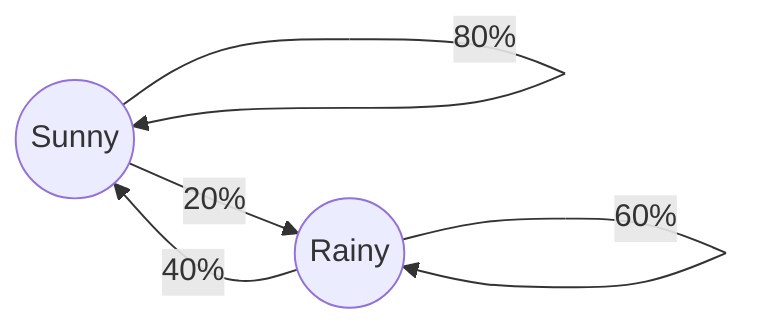

# Demystifying the Math of Probability: Markov Chains vs. Markov Decision Processes

Have you ever wondered how Google ranks billions of web pages in a fraction of a second? Or how an AI autopilot learns to steer a drone through a crowded room? 

At the heart of these modern technological marvels lies a branch of mathematics dedicated to modeling the future. If you dive into the worlds of data science, physics, economics, or artificial intelligence, you will inevitably run into two foundational concepts: **Markov Chains** and **Markov Decision Processes (MDPs)**. 

While they sound intimidatingly similar, they serve two fundamentally different purposes. **Markov Chains model passive, random systems, while Markov Decision Processes model active, goal-oriented decision-making.**

Let's break down exactly what they are, how they work, and how to tell them apart.

---

## 1. What is a Markov Chain?

A **Markov Chain** is a mathematical framework that models a sequence of random events where the probability of the next event depends *entirely* on the current state, not on the past history. 

This core characteristic is known as the **Markov Property** (or memorylessness). The system effectively forgets how it arrived at its current position; all that matters for the future is the present.

### The Core Components
* **States ($S$):** A set of all possible conditions the system can be in.
* **Transition Probabilities ($P$):** The likelihood of moving from one specific state to another in a single time step. 

### A Classic Example: The Weather Model
Imagine a town where tomorrow's weather depends strictly on today's weather. We can map out the system like this:
* If it is **Sunny** today, there is an 80% chance it stays Sunny tomorrow, and a 20% chance it becomes **Rainy**.
* If it is **Rainy** today, there is a 60% chance it stays Rainy tomorrow, and a 40% chance it clears up to be **Sunny**.

In a Markov Chain, this system runs completely on autopilot. You plug in a starting state, roll the mathematical dice, and watch the system evolve over time.

---

## 2. What is a Markov Decision Process (MDP)?

A **Markov Decision Process (MDP)** takes the foundation of a Markov Chain and introduces an active participant: an **Agent**. 

Instead of just watching a random process unfold, the agent interacts with the environment by making choices. Every time the agent takes an action, it influences the transition probabilities of the system and receives feedback in the form of rewards or penalties. 

### The Core Components
An MDP expands the Markov Chain into five distinct mathematical elements:
* **States ($S$):** The current configurations of the environment.
* **Actions ($A$):** The set of choices available to the agent in each state.
* **Transition Probabilities ($P$):** The chance of moving to a new state *given the current state and the chosen action*.
* **Rewards ($R$):** The immediate points or feedback the agent receives after taking an action.
* **Discount Factor ($\gamma$):** A value between 0 and 1 that determines how much the agent values immediate rewards versus long-term rewards.

### Expanding the Weather Example
Let's turn our passive weather model into an MDP. You are now the agent, and your goal is to maximize your comfort. 
* **Your States:** Sunny or Rainy.
* **Your Actions:** You can choose to **Go for a Walk** or **Stay Indoors**.
* **The Rewards:** Going for a walk on a sunny day gives you $+10$ joy. Going for a walk on a rainy day gets you soaked, resulting in a $-5$ penalty. Staying indoors is safe, yielding a neutral $+2$ joy regardless of the weather.

Now, the system isn't just randomly shifting—your choices actively dictate your experience and your score. The ultimate goal of an MDP is to calculate the **Optimal Policy ($\pi$)**, which is essentially a master strategy guide telling the agent the absolute best action to take in any given state to get the highest possible score over time.

---

## 3. Key Differences: Side-by-Side Comparison

To firmly cement how these two frameworks differ, let’s look at them across their core characteristics:

| Feature | Markov Chain | Markov Decision Process (MDP) |
| :--- | :--- | :--- |
| **System Nature** | **Passive.** A purely random process observed from the outside. | **Active.** An interactive system driven by an agent's choices. |
| **Control** | **None.** Transitions occur automatically based on fixed probabilities. | **High.** The agent selects actions to deliberately steer the system. |
| **Mathematical Goal** | To predict or analyze the long-term behavior/steady state of a system. | To find the **Optimal Policy** that maximizes cumulative rewards. |
| **Transition Math** | $P(s' \mid s)$   *(Next state depends only on current state)* | $P(s' \mid s, a)$   *(Next state depends on current state and chosen action)* |
| **Key Elements** | States, Transition Matrix. | States, Actions, Transition Probabilities, Rewards, Discount Factor. |

### The Ultimate Analogy: Passenger vs. Driver
Think of a **Markov Chain** like riding in a self-driving car with no GPS. At every intersection, the car randomly decides whether to turn left, right, or go straight based on a set probability. You are just a passenger along for the ride, tracking where the car ends up.

An **MDP**, on the other hand, puts you in the driver’s seat of a delivery truck. At every intersection, you choose where to turn. Turning toward a customer gets you money (Reward), while turning down a congested street costs you time (Penalty). You are actively navigating the environment to maximize your profits.

---

## 4. Real-World Applications

Because their structures are so distinct, they are utilized in entirely different fields of technology and science.

### Where Markov Chains Excel
* **Search Engine Algorithms:** Google's original *PageRank* algorithm treats the internet as a massive Markov Chain, simulating a random surfer clicking links to see which web pages are naturally visited most often.
* **Text Autocomplete:** The keyboard on your phone looks at the word you just typed (the current state) and references a Markov Chain to guess the most probable next word.
* **Financial Modeling:** Economists use them to model market regimes, predicting the probability of transitioning from a Bull market to a Bear market.

### Where MDPs Excel
* **Reinforcement Learning & AI:** MDPs are the foundational math behind modern AI. When an AI learns to play chess, master video games, or pilot a robotic arm, it treats the game as an MDP.
* **Autonomous Driving:** A self-driving car continuously evaluates its state (lane position, nearby cars) and takes actions (steer, brake, accelerate) to safely reach a destination while maximizing safety rewards.
* **Inventory Management:** Businesses use MDPs to decide exactly when and how much warehouse stock to reorder to minimize storage costs while avoiding running out of products.

---

## Conclusion

Understanding the boundary between a Markov Chain and a Markov Decision Process comes down to identifying whether a system is **observed** or **managed**. 

If you are dealing with a natural, unalterable sequence of random events—like the weather or the natural degradation of mechanical parts—you use a **Markov Chain**. If you introduce an intelligent agent capable of making choices to alter that sequence for a specific goal—like a robot navigating a maze or an investor trading stocks—you have stepped into the realm of a **Markov Decision Process**.

Both frameworks elegantly leverage the "memoryless" Markov property, proving that sometimes, you don't need to know the entire history of the world to perfectly plan your next move.