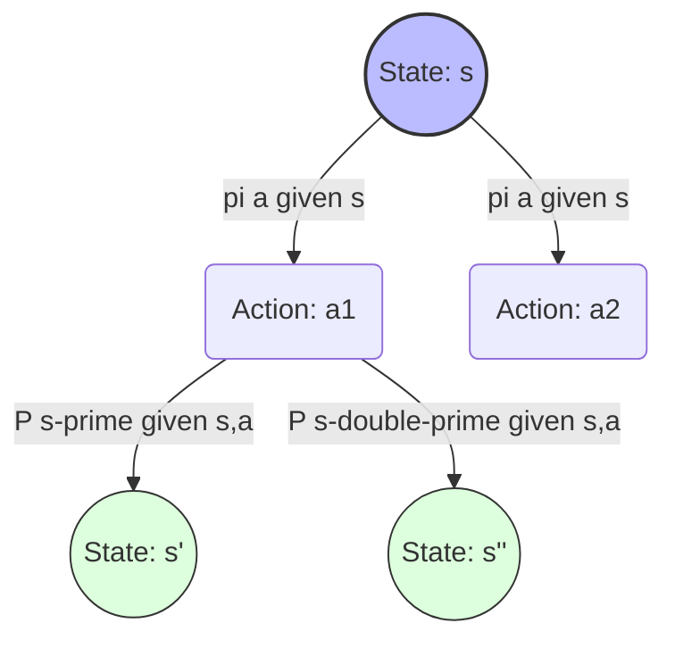
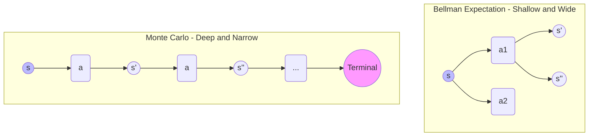

# Mastering Reinforcement Learning: Monte Carlo Evaluation vs. The Bellman Expectation Equation

If you have ever dipped your toes into the world of Reinforcement Learning (RL), you have likely run into a wall of intense-looking mathematical notation. Words like "bootstrapping," "expectation," and "trajectory" fly around, leaving many beginners wondering how it all fits together.

At the very core of Reinforcement Learning lies the **Prediction Problem**: *If an agent follows a specific strategy (a policy $\pi$), how can we accurately estimate the value of being in any given state?*

To solve this, RL relies on two foundational titans: **Monte Carlo (MC) Policy Evaluation** and the **Bellman Expectation Equation**. 

While one relies on raw, brute-force experience, the other relies on elegant mathematical recursion. In this post, we will tear down the math, look at how they operate, and discover how these two seemingly different concepts are deeply intertwined parts of the same puzzle.

---

## 1. What is Monte Carlo Policy Evaluation?

**Monte Carlo (MC) Policy Evaluation** is an experiential, data-driven approach to solving the prediction problem. It answers a simple question: *What is the value of a state? Let’s run a bunch of trials, see what rewards we get, and average them out.*

### The Core Logic: Learning from Complete Trajectories
Monte Carlo methods are **model-free**, meaning the agent does not need to know the physics or transition probabilities of its environment. It learns purely from trial and error. 

To evaluate a policy, the agent starts at an initial state and interacts with the environment until it reaches a terminal (end) state. This complete sequence of states, actions, and rewards is called an **episode**:

Once the episode terminates, the algorithm works **backward** from the end to calculate the total accumulated reward from each time step, known as the **Return ($G_t$)**:

$$G_t = R_{t+1} + \gamma R_{t+2} + \gamma^2 R_{t+3} + \dots = \sum_{k=0}^{T-t-1} \gamma^k R_{t+k+1}$$

*(Where $\gamma$ is the discount factor between 0 and 1, ensuring the agent values immediate rewards more than distant future rewards).*

### The Mathematical Rule
According to the Law of Large Numbers, if an agent visits a state $s$ an infinite number of times across many episodes, the average of the observed returns will perfectly converge to the true value $V(s)$:

$$V(s) \approx \text{Average}(G_t \text{ for all times where } S_t = s)$$

### Variations: First-Visit vs. Every-Visit
If an agent loops back and visits the same state multiple times in a single episode, we have two ways to calculate the average:
*   **First-Visit MC:** You only record and average the return ($G_t$) following the *very first time* the state is hit in that episode.
*   **Every-Visit MC:** You treat every single occurrence of the state in that episode as a separate data point and average all of them.

---

## 2. What is the Bellman Expectation Equation?

While Monte Carlo forces you to wait until the very end of an episode to learn anything, the **Bellman Expectation Equation** takes a radically different, recursive approach. Named after Richard Bellman, it allows an agent to calculate a state's value step-by-step **without waiting for the episode to finish**.

### The Core Logic: Value Decomposition
The brilliance of the Bellman Equation lies in breaking down the long-term Return ($G_t$) into two clean components:
1. The **immediate reward** you get right now ($R_{t+1}$).
2. The **discounted value of the next state** you land in ($\gamma V(S_{t+1})$).

Mathematically, it looks like this:

$$\mathbf{V(s) = \mathbb{E} [R_{t+1} + \gamma V(S_{t+1}) \mid S_t = s]}$$

This is known as **bootstrapping**—estimating a guess based on another guess. If you know the exact probabilities of your environment, you don't need to run simulations; you can turn this equation into a system of linear equations and solve for the value of every state simultaneously.

### The Breakdown of the State-Value Equation $V^\pi(s)$
To compute the overall value of standing in a state $s$ under a policy $\pi$, you must look at every action you might take, and every state those actions might lead to:

$$V^\pi(s) = \sum_{a \in A} \pi(a \mid s) \sum_{s' \in S} P(s' \mid s, a) \left[ R(s, a, s') + \gamma V^\pi(s') \right]$$

*   **$\pi(a \mid s)$:** The probability that your policy chooses a specific action.
*   **$P(s' \mid s, a)$:** The environmental probability that your action actually lands you in a specific next state.
*   **$R(s, a, s') + \gamma V^\pi(s')$:** The immediate reward plus the discounted future value of that next state.

---

## 3. How Are They Related?

At first glance, they seem like complete opposites: Monte Carlo uses empirical, real-world sampling, while Bellman uses structural, theoretical expectation. Yet, **they are mathematically identical in expectation.** 

Here is exactly how they bridge together:

### 1. The Expectation Bridge
By definition, the value of a state is the expected value of the return: $V(s) = \mathbb{E}[G_t \mid S_t = s]$. 
*   **Monte Carlo** directly samples this expectation by running the code out to infinity and calculating the mean of $G_t$. 
*   **The Bellman Equation** mathematically expands that exact same expectation term ($\mathbb{E}$) into a localized, one-step recursive look-ahead. 

Monte Carlo is the *sample-based realization* of what the Bellman Expectation Equation dictates in theory. 

### 2. The Interaction Matrix
We can visualize how these two methods navigate the look-ahead tree of Reinforcement Learning. 

*   **Monte Carlo** traces a single, deep, narrow path all the way to the end of the tree.
*   **Bellman Expectation** averages all possible shallow, wide branches exactly one step forward.

### 3. Temporal Difference Learning: The Ultimate Child of Both
The relationship between Monte Carlo and Bellman becomes beautifully explicit when you look at **Temporal Difference (TD) Learning** (like TD(0)). 

TD learning wants the sample-based freedom of Monte Carlo (no model required), but it wants the step-by-step speed of the Bellman Equation (no waiting for the episode to end). It combines them into one update rule:

$$V(S_t) \leftarrow V(S_t) + \alpha \underbrace{[ \overbrace{R_{t+1} + \gamma V(S_{t+1})}^{\text{Bellman Target}} - V(S_t) ]}_{\text{TD Error (Sampled like MC)}}$$

---

## Summary Side-by-Side Comparison

| Feature | Monte Carlo Policy Evaluation | Bellman Expectation Equation |
| :--- | :--- | :--- |
| **Operational Strategy** | **Sampling.** Runs full episodes to gather actual data points. | **Analytical.** Uses mathematical recursion to evaluate states. |
| **Bootstrapping** | **No.** Values are updated using true, terminal rewards. | **Yes.** Updates state values based on estimated values of next states. |
| **Environmental Knowledge** | **Model-Free.** Requires no prior knowledge of probabilities. | **Model-Based.** Requires transition probabilities ($P$) and rewards ($R$). |
| **Variance vs. Bias** | **High Variance, Zero Bias.** Every episode is wildly different, but accurate. | **Low Variance, High Bias.** Stable to calculate, but errors compound early on. |
| **Execution Constraint** | Can only be used on **Episodic tasks** that eventually end. | Can be used on **Continuous tasks** that run forever. |

## Conclusion

Monte Carlo Evaluation and the Bellman Expectation Equation are two sides of the same coin. Monte Carlo is what happens when you roll up your sleeves, jump into the environment, and measure what actually happens over time. The Bellman Expectation Equation is the underlying rules of the universe that dictate what those averages *should* ideally converge to. 

By mastering both, you gain a complete spatial understanding of how an AI calculates value—setting you up perfectly to conquer advanced control algorithms like Q-Learning and Policy Gradients!
