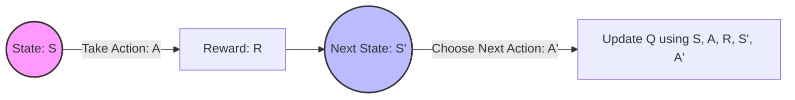
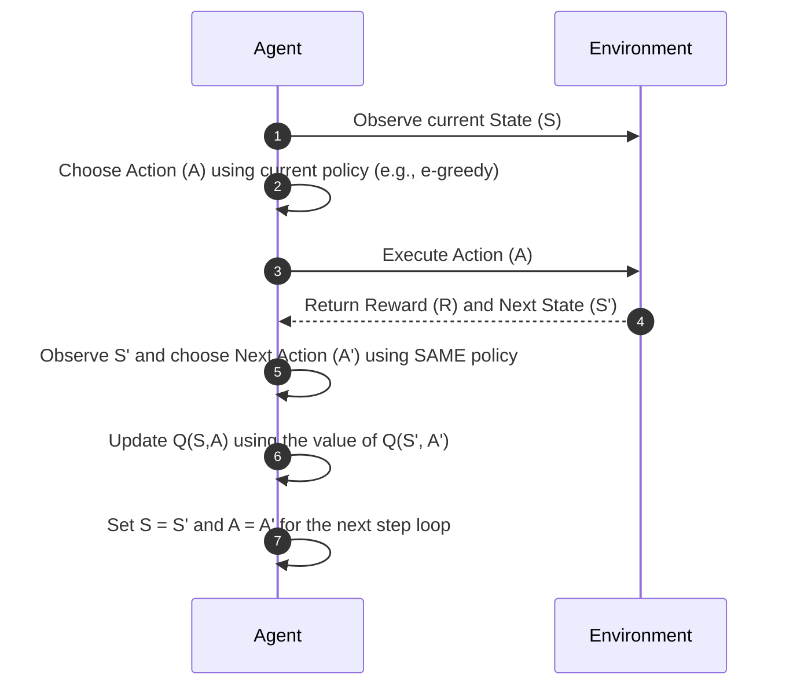
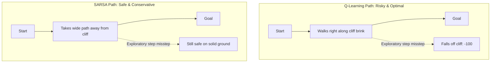
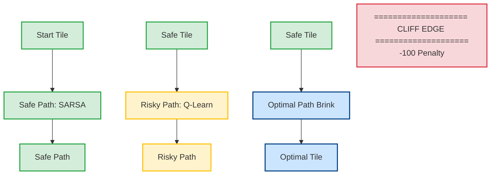

# Understanding SARSA: An On-Policy Temporal Difference Learning Algorithm

In reinforcement learning, **SARSA** is an **on-policy Temporal Difference (TD) control algorithm** used to find an optimal policy for an agent operating in an environment. 

The name **SARSA** is an acronym for the specific sequence of elements the algorithm uses to update its Q-values: **S**tate, **A**ction, **R**eward, **S**tate, **A**ction.

---

## 1. The Core Idea Behind SARSA

SARSA updates its action-value function (Q-function) based on the actual trajectory the agent takes. It evaluates and improves the **exact policy** that it is currently executing to choose actions. This makes it an **on-policy** algorithm.

### The SARSA Sequence
1. **S**: The agent begins in a current **State**.
2. **A**: The agent chooses an **Action** based on its current policy (e.g., ε-greedy).
3. **R**: The agent executes the action and receives an immediate **Reward**.
4. **S'**: The agent transitions to the next **State**.
5. **A'**: The agent immediately selects the **next Action** from S' *using the exact same policy*.



---

## 2. The SARSA Update Equation

The mathematical formula used to update the Q-value for a state-action pair (S, A) is:

$$Q(S, A) \leftarrow Q(S, A) + \alpha \left[ R + \gamma Q(S', A') - Q(S, A) \right]$$

### Parameter Breakdown
* **Q(S, A)**: The current estimated value of taking action A in state S.
* **α (Learning Rate)**: Controls how much the new information overrides the old estimation (0 < α ≤ 1).
* **R**: The immediate reward received after executing action A.
* **γ (Discount Factor)**: Determines the importance of future rewards (0 ≤ γ ≤ 1).
* **Q(S', A')**: The estimated value of taking the **chosen next action A'** in the next state S'.
* **$\left[ R + \gamma Q(S', A') - Q(S, A) \right]$**: This represents the **Temporal Difference (TD) Error**.

When you first start, you don't actually estimate $Q(S', A')$ from experience—you **initialize it with a placeholder guess**. 

Before the agent ever interacts with the environment, you must initialize a **Q-table** (or a neural network) containing a starting value for every single possible state-action pair. 

---

### 1. The Initial Guess (Arbitrary Initialization)

Common practices for initializing your Q-values include:
* **Zero Initialization:** Set every single $Q(S, A) = 0$.
* **Optimistic Initialization: (Recommended)** Set all initial values to a high number (e.g., all ones if rewards are typically negative). This forces the agent to explore everything at least once because unvisited states look highly promising.
* **Random Initialization:** Fill the Q-table with small random values.

---

### 2. How the Math Corrects Itself (The Domino Effect)

Let's see how the formula works during the **very first transition** of an episode using a zero-initialized table ($Q = 0$), a learning rate $\alpha = 0.5$, and a discount factor $\gamma = 0.9$:

1. **Start:** The agent is in State $S_0$. It picks Action $A_0$.
2. **Step:** It executes $A_0$, lands in State $S_1$, and receives a real environment reward: **$R = +10$**.
3. **Lookahead:** The agent checks its table for the next action $A_1$ in state $S_1$. Because the table is initialized to zero, **$Q(S_1, A_1) = 0$**. 
4. **The Update Calculation:**

$$\text{TD Error} = R + \gamma Q(S_1, A_1) - Q(S_0, A_0)$$

$$\text{TD Error} = 10 + 0.9(0) - 0 = 10$$

$$Q(S_0, A_0) \leftarrow 0 + 0.5(10) = 5$$

Even though the lookahead value $Q(S_1, A_1)$ was a completely "wrong" guess ($0$), **the real reward ($R = +10$) dragged the value of $Q(S_0, A_0)$ upward.** 

As the agent moves through the environment, true rewards slowly backpropagate backward through the states, step-by-step, correcting your initial placeholder guesses into accurate value estimates over multiple episodes.

---

## 3. SARSA Step-by-Step Workflow

Unlike Q-learning (which assumes the absolute best possible action will be taken in the next step), SARSA waits to see what action A' its policy *actually* selects before making its update.



---

## 4. SARSA Algorithm Pseudo-code

```text
Initialize Q(s, a) arbitrarily, and Q(terminal-state, ·) = 0
For each episode:
    Initialize S
    Choose A from S using policy derived from Q (e.g., ε-greedy)
    For each step of episode:
        Take action A, observe R, S'
        Choose A' from S' using policy derived from Q (e.g., ε-greedy)
        Q(S, A) ← Q(S, A) + α [R + γ Q(S', A') - Q(S, A)]
        S ← S'
        A ← A'
    Until S is terminal
```

---

## 5. Direct Comparison: SARSA vs. Q-Learning

The primary distinction lies in how they handle the look-ahead value for the next state.

### Visualizing Behavior (The Cliff Walking Example)
Imagine a grid world where a cliff edge yields a -100 penalty. Because ε-greedy exploration occasionally forces random actions, SARSA learns a longer, safer path further away from the cliff edge to avoid accidentally tumbling off during exploration. Q-learning learns the absolute optimal path right along the brink, frequently falling off during training due to exploratory steps.



### Deep Dive: How Q-Learning Differs from SARSA

While both SARSA and Q-Learning are Temporal Difference (TD) control algorithms that learn a Q-table, the fundamental difference lies in their **update philosophy**: **SARSA is On-Policy**, whereas **Q-Learning is Off-Policy**.

---

#### 1. Mathematical Comparison of Updates

The core difference is highlighted directly in their mathematical update equations. Pay close attention to how each algorithm handles the lookahead value for the next state $S'$.

##### SARSA (On-Policy)
$$\quad Q(S, A) \leftarrow Q(S, A) + \alpha \left[ R + \gamma Q(S', A') - Q(S, A) \right]$$

##### Q-Learning (Off-Policy)
$$\quad Q(S, A) \leftarrow Q(S, A) + \alpha \left[ R + \gamma \max_{a} Q(S', a) - Q(S, A) \right]$$

* **SARSA** uses $Q(S', A')$, meaning it evaluates the value of the **actual next action $A'$** chosen by its current behavior policy (e.g., $\epsilon$-greedy).
* **Q-Learning** uses $\max_{a} Q(S', a)$, meaning it completely ignores what action the behavior policy actually chooses next. Instead, it assumes it will follow a completely greedy policy and pick the absolute best possible action available in $S'$.

---

#### 2. Conceptual Workflow Disconnect

To see the operational difference, observe how their step-by-step loops progress.

```mermaid
graph TD
    subgraph SARSA Loop On-Policy
        S1[State S] --> A1[Action A via e-greedy]
        A1 --> R1[Execute Action -> Get Reward R and State S-prime]
        R1 --> A2[Choose Next Action A-prime via e-greedy]
        A2 --> U1[Update Q using current S-prime and A-prime]
        U1 --> Next1[Next step starts with S-prime and pre-chosen A-prime]
    end

    subgraph Q-Learning Loop Off-Policy
        S2[State S] --> A3[Action A via e-greedy]
        A3 --> R2[Execute Action -> Get Reward R and State S-prime]
        R2 --> U2[Update Q using optimal max Action over S-prime]
        U2 --> A4[Choose Next Action A-prime via e-greedy]
        A4 --> Next2[Next step starts with S-prime and new A-prime]
    end

    style U1 fill:#f9f,stroke:#333
    style U2 fill:#bbf,stroke:#333
```



Notice that **SARSA must select $A'$ before it can update $Q(S, A)$**, and it is locked into executing that $A'$ in the next time step. **Q-Learning updates $Q(S, A)$ immediately** upon seeing $S'$, and only picks its actual next execution action afterward.

---

#### 3. Comprehensive Feature Comparison Table

| Feature | SARSA | Q-Learning |
| :--- | :--- | :--- |
| **Policy Type** | **On-Policy**: Learns the value of the policy being executed (including its exploratory mistakes). | **Off-Policy**: Learns the value of the optimal greedy policy, independent of exploratory actions. |
| **Lookahead target** | Uses the value of the actual next action: $Q(S', A')$. | Uses the value of the maximum potential action: $\max_{a} Q(S', a)$. |
| **Risk Tolerance** | **Conservative / Safe**: Paths steer clear of negative traps because random exploration might trigger them. | **Aggressive / Optimistic**: Assumes it will always act perfectly in the future, disregarding exploration risks. |
| **Convergence** | Converges to the optimal policy *if* $\epsilon$ is gradually reduced to 0. | Converges to the optimal policy directly, even while maintaining a constant $\epsilon$. |

---

#### 4. Practical Example: The Cliff Walking Scenario

To understand why this technical nuance matters, look at the classic **Cliff Walking** environment. An agent must travel from a start tile to a goal tile along a grid layout. The bottom edge of the grid is a deadly cliff yielding a heavy penalty ($R = -100$). All other steps yield a minor penalty ($R = -1$).



#### Why their chosen paths diverge:
* **Q-Learning** finds the **Optimal Path** right along the brink of the cliff. It assumes a future greedy policy ($\max$). In a perfect world without exploration, walking the edge is the fastest route to the goal. However, during training, its $\epsilon$-greedy exploration occasionally forces a random step, causing the agent to constantly fall off the cliff.
* **SARSA** finds the **Safe Path** further inland. Because SARSA looks at the action $A'$ it *actually* takes next, its math catches when an exploratory action accidentally throws it over the cliff edge. It realizes that walking too close to the cliff is dangerous under an exploratory policy, and naturally paths itself a safe distance away from the hazard.
