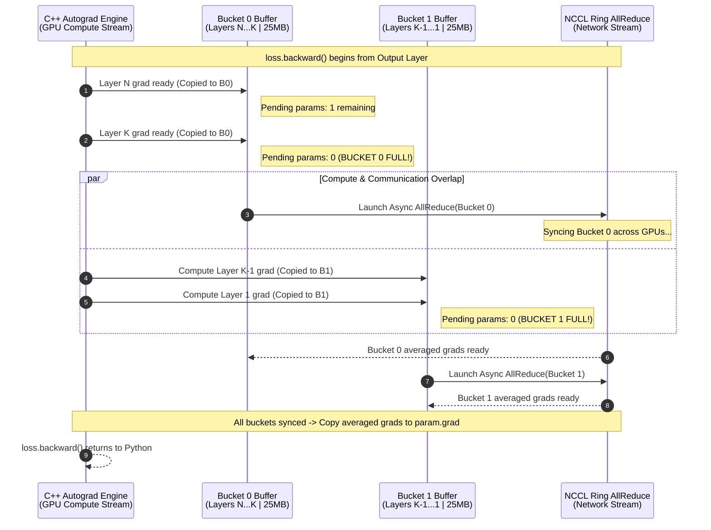
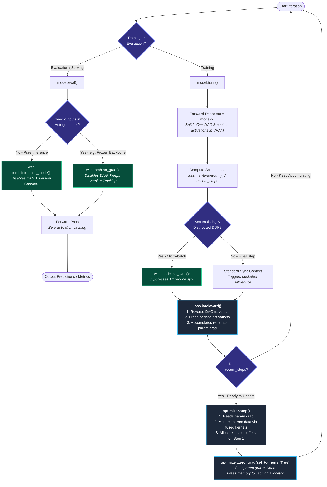

# Under the Hood of PyTorch Autograd: `backward()`, `step()`, `zero_grad()`, and Inference Modes

For senior ML engineers, `zero_grad()`, `backward()`, and `step()` are muscle memory. However, when scaling distributed training (DDP/FSDP), optimizing VRAM ceilings on large models, or writing custom autograd functions, treating these calls as black-box abstractions leaves significant performance on the table—or introduces subtle mathematical bugs.

Let’s strip away the introductory metaphors and look at what PyTorch’s C++ autograd engine, allocator, and optimizer states are actually doing under the hood.

---

## 1. Overview


### 1. The Core Engine: `loss.backward()` vs. `optimizer.step()`

Training a neural network comes down to two distinct phases: **figuring out what went wrong** and **fixing it**. PyTorch separates these responsibilities into two functions.

#### `loss.backward()`: The Diagnosis
When you pass data through your model (the forward pass), PyTorch dynamically builds a **computation graph** that tracks every mathematical operation applied to your tensors. 

When you call `loss.backward()`:
* PyTorch traverses this computation graph backward from the loss tensor to every parameter with `requires_grad=True`.
* It uses the chain rule of calculus to compute the gradient of the loss with respect to each weight and bias.
* It stores these calculated gradients inside each parameter's `.grad` attribute (e.g., `layer.weight.grad`).

**Crucial takeaway:** `loss.backward()` *only* calculates gradients. It does not change a single weight in your model.

#### `optimizer.step()`: The Action
Once the gradients are stored in `.grad`, the optimizer takes over. The optimizer (such as `torch.optim.SGD` or `torch.optim.Adam`) holds references to all your model's parameters.

When you call `optimizer.step()`:
* The optimizer reads the `.grad` values attached to each parameter.
* It updates the actual weights using those gradients and its internal optimization rules (like learning rate, momentum, or adaptive weight decay).

**Crucial takeaway:** Without `optimizer.step()`, your model computes how to improve, but never actually updates itself. Without `loss.backward()`, `optimizer.step()` has no gradients to read and does nothing.

### 2. Memory Management: When to Use `optimizer.zero_grad()` vs. Not

A common surprise for newcomers is that **PyTorch accumulates gradients by default**. Every time you call `loss.backward()`, the newly computed gradients are *added* (`+=`) to whatever values are already sitting in `.grad`, rather than overwriting them.

#### When You SHOULD Call `optimizer.zero_grad()`
In **95% of standard training loops**, you want to call `optimizer.zero_grad()` at the start of every batch iteration (or right after `optimizer.step()`). 

If you forget to zero out the gradients, the gradient from Batch 2 will be added to the gradient from Batch 1. By Batch 10, your updates will be driven by a messy, outdated sum of all previous batches, causing your training to diverge.

*Pro-tip: Using `optimizer.zero_grad(set_to_none=True)` is slightly faster and uses less memory than the default `set_to_none=False`, as it deletes the gradient tensors rather than filling them with zeros.*

#### When You SHOULD NOT Call `optimizer.zero_grad()`
PyTorch accumulates gradients on purpose because it unlocks several powerful training patterns:

1. **Gradient Accumulation (Simulating Large Batches):**
   Suppose you want to train with a batch size of 64, but your GPU runs out of memory (OOM) with anything larger than 16. You can run 4 forward and backward passes with a batch size of 16 *without* calling `zero_grad()`. The gradients sum up across the 4 mini-batches. On the 4th step, you call `optimizer.step()` and then `optimizer.zero_grad()`. Mathematically, this is nearly identical to training with a batch size of 64.
2. **Multi-Task Learning / Multiple Losses:**
   If your model outputs two predictions and you compute `loss_a` and `loss_b` separately, you can call `loss_a.backward()` followed by `loss_b.backward()`. Because gradients accumulate, `.grad` will cleanly hold the combined gradients of both losses before you call `optimizer.step()`.
3. **Recurrent Neural Networks (BPTT):**
   When backpropagating through time across sequence chunks, accumulating gradients across time steps is often required before updating weights.

### 3. Turning Off the Engine: When to Use `torch.no_grad()`

Building the computation graph and storing intermediate layer outputs (activations) during the forward pass takes a massive amount of GPU memory and compute time. PyTorch only needs this graph if you plan to call `loss.backward()` later.

Wrapping your code in a `with torch.no_grad():` context manager tells PyTorch: *"Do not track operations, do not build a computation graph, and do not store intermediate activations."*

#### Quick Decision Matrix

| Scenario | Use `torch.no_grad()`? | Why? |
| :--- | :--- | :--- |
| **Training Loop** | **No** | You need the computation graph to run `loss.backward()`. |
| **Validation / Testing** | **Yes** | You are only measuring loss/accuracy. Disabling autograd prevents OOM crashes and speeds up evaluation. |
| **Production Inference** | **Yes** | You only want predictions and will never train on this pass. |
| **Manual Weight Updates** | **Yes** | If you manually modify weights (e.g., `param -= lr * param.grad` or custom initialization), doing so outside `no_grad()` will corrupt the autograd history. |
| **Freezing Backbone Layers** | **Optional** | While setting `requires_grad = False` stops weight updates, wrapping frozen feature extractors in `no_grad()` saves even more activation memory. |

### `torch.no_grad()` vs. `model.eval()`
A frequent point of confusion is thinking `torch.no_grad()` replaces `model.eval()`. **They do completely different things and should be used together during evaluation:**
* **`model.eval()`** changes the *behavior* of specific layers (e.g., turning off Dropout and freezing running statistics in BatchNorm). It does **not** turn off gradient tracking.
* **`torch.no_grad()`** turns off *autograd graph creation* to save memory and speed up math. It does **not** change Dropout or BatchNorm behavior.

### 4. Putting It All Together: The Complete Blueprint

Here is how all four pieces fit together in a clean, production-ready PyTorch loop, including an example of gradient accumulation:

```python
import torch
import torch.nn as nn

# Setup dummy model, loss, and optimizer
model = nn.Linear(10, 1)
criterion = nn.MSELoss()
optimizer = torch.optim.Adam(model.parameters(), lr=1e-3)

accumulation_steps = 4  # Set to 1 for standard training

# ==========================================
# 1. TRAINING PHASE (Autograd ON)
# ==========================================
model.train()  # Enable Dropout, BatchNorm updates, etc.
optimizer.zero_grad(set_to_none=True)  # Start with clean gradients

for step, (inputs, targets) in enumerate(train_loader):
    # Forward pass: builds computation graph
    predictions = model(inputs)
    loss = criterion(predictions, targets)
    
    # Normalize loss if accumulating gradients
    loss = loss / accumulation_steps
    
    # Backward pass: computes and accumulates gradients in .grad
    loss.backward()
    
    # Update weights only after accumulating enough gradients
    if (step + 1) % accumulation_steps == 0:
        optimizer.step()                       # Apply gradients to weights
        optimizer.zero_grad(set_to_none=True)  # Reset gradients for next cycle

# ==========================================
# 2. VALIDATION / INFERENCE PHASE (Autograd OFF)
# ==========================================
model.eval()  # Switch layers to evaluation mode
val_loss = 0.0

with torch.no_grad():  # Disable computation graph to save memory & time
    for val_inputs, val_targets in val_loader:
        val_predictions = model(val_inputs)
        val_loss += criterion(val_predictions, val_targets).item()

print(f"Validation Loss: {val_loss / len(val_loader):.4f}")
```

### Summary Checklist
* **`loss.backward()`**: Calculates gradients and adds them to `.grad`.
* **`optimizer.step()`**: Uses `.grad` to update model weights.
* **`optimizer.zero_grad()`**: Clears `.grad` so batches don't bleed into each other (skip only when intentionally accumulating gradients).
* **`torch.no_grad()`**: Disables graph tracking to save memory and boost speed whenever you aren't calling `.backward()`.


## 2. Execution Mechanics: `loss.backward()` vs. `optimizer.step()`

PyTorch separates gradient computation from parameter mutation to keep the autograd engine agnostic to the optimization algorithm.

### `loss.backward()`: Graph Traversal and Hook Execution
During the forward pass, the autograd engine dynamically constructs a Directed Acyclic Graph (DAG) of `Node` (`grad_fn`) objects representing backward operations, saving references to intermediate activations required for the Jacobian-vector product (JVP/VJP).

When `loss.backward()` is invoked:
1. **Topological Sort & Execution:** The C++ engine traverses the DAG in reverse topological order starting from `loss.grad_fn`.
2. **Activation Release:** By default (`retain_graph=False`), intermediate buffers saved on the graph are freed immediately as each `Node` finishes executing.
3. **Accumulation & Hooks:** Leaf tensors (`is_leaf=True` and `requires_grad=True`) have their gradients accumulated into `tensor.grad` via `AccumulateGrad` nodes. Any registered backward hooks (`register_post_accumulate_grad_hook`) fire here.
4. **DDP Communication:** In DistributedDataParallel, gradient bucketing and asynchronous `AllReduce` calls are triggered dynamically during `backward()` as soon as buckets fill up—overlapping communication with backward compute.

**Key distinction:** `backward()` strictly populates `.grad` buffers and triggers communication/hooks. Parameter data pointers remain untouched.

### `optimizer.step()`: State Updates and Kernel Fusion
`optimizer.step()` iterates over `param_groups`, reading `p.grad` to update `p.data` in-place (under an internal `@torch.no_grad()` context so parameter updates are not recorded in the DAG).

* **State Allocation:** Stateful optimizers like Adam/AdamW lazily initialize momentum (`exp_avg`) and variance (`exp_avg_sq`) buffers on the *first* `step()` call—causing a noticeable VRAM spike at Step 1 rather than Step 0.
* **Kernel Efficiency:** Modern PyTorch implementations default to `foreach=True` (multi-tensor apply) or `fused=True` (single CUDA kernel for the entire parameter update), avoiding Python loop overhead and launch latency across hundreds of parameter tensors.

### Deep Dive: When to Actually Use `retain_graph=True` (and `create_graph=True`)

By default (`retain_graph=False`), PyTorch’s C++ autograd engine is aggressively memory-conscious: the exact microsecond a `grad_fn` node finishes computing its local Jacobian-vector product, its saved forward activations are deallocated. Attempting a second `.backward()` call on any downstream tensor triggers the classic `RuntimeError: Trying to backward through the graph a second time...`.

Setting `retain_graph=True` overrides this cleanup, keeping intermediate activation buffers alive in VRAM after traversal. You only want to pay this memory penalty in specific architectural patterns:

1. **Multi-Objective Backprop with Separate Optimizers or Gradient Inspection:**
   If a shared backbone (`h = encoder(x)`) feeds two heads (`loss_1` and `loss_2`) and you need to inspect per-task gradient norms (e.g., for GradNorm or PCGrad) or step separate optimizers, you must preserve the shared encoder's activations on the first pass:
   ```python
   # 1. Backprop first loss, keeping shared backbone activations in VRAM
   loss_1.backward(retain_graph=True)
   encoder_grad_norm_1 = encoder.weight.grad.norm().item()

   # 2. Backprop second loss (accumulates into encoder.weight.grad) and free the graph
   loss_2.backward(retain_graph=False)
   ```
   *(Note: If you are using a single optimizer and don't need separate gradient metrics, simply compute `(loss_1 + loss_2).backward()` in one pass without `retain_graph=True`.)*

2. **Per-Sample Gradients & Jacobians (Legacy Loops):**
   When computing per-example gradients (e.g., for Differential Privacy / DP-SGD or influence functions) without `torch.func` (`vmap`), looping over `loss[i].backward(retain_graph=(i < B - 1))` preserves the shared graph until the final sample in the batch is processed.

3. **Actor-Critic / Shared-Trunk RL Rollouts:**
   When policy ($\pi$) and value ($V$) heads share feature layers and are updated via sequential backward passes over the same rollout tensor.

#### Common Pitfalls: What `retain_graph=True` is *Not* For
* **Standard Gradient Accumulation:** Each micro-batch executes a brand-new forward pass and constructs an independent DAG. Leaving `retain_graph=False` safely frees each micro-batch's activations while preserving `param.grad`.
* **Higher-Order Gradients (MAML, WGAN-GP Gradient Penalties):** `retain_graph=True` only keeps *forward* activations alive; it does not record the backward operations themselves into a differentiable graph. To compute gradients of gradients ($\nabla_\theta \|\nabla_x D(x)\|_2$), you must pass **`create_graph=True`** (which implicitly sets `retain_graph=True`).

#### Why You Don't Need `retain_graph=True` for Multi-Head Models with a Single Optimizer

If you have two different heads (`loss_1` and `loss_2`) attached to a shared backbone and update everything with a **single optimizer**, you **do not** need `retain_graph=True`. Instead, sum the losses first (`total_loss = loss_1 + loss_2`) and call `total_loss.backward()` once.

##### How a Single `.backward()` Handles Both Heads
Mathematically, `(loss_1 + loss_2).backward()` produces the exact same gradients as calling `loss_1.backward(retain_graph=True)` followed by `loss_2.backward()`, but it is faster and uses less VRAM:

1. **Graph Merging:** Adding `loss_1 + loss_2` creates a single root node (`AddBackward0`) at the top of the computation graph.
2. **Single Backbone Traversal:** PyTorch's C++ autograd engine traverses down through `head_1` and `head_2` independently, sums their incoming gradients at the junction where they meet the shared backbone, and backpropagates through the backbone in **one single pass**.
3. **Immediate Cleanup:** Because the shared backbone is only visited once, PyTorch can safely free its intermediate activations (`retain_graph=False`) the moment it finishes traversing them.

##### Comparison: Two Passes vs. One Combined Pass

| Approach | Code Pattern | Backbone Passes | Needs `retain_graph=True`? | Performance & VRAM |
| :--- | :--- | :--- | :--- | :--- |
| **Separate Calls** | `loss_1.backward(retain_graph=True)`<br>`loss_2.backward()` | 2 backward passes | **Yes** | Slower; holds backbone activations in VRAM until `loss_2` finishes. |
| **Combined Loss** | `(loss_1 + loss_2).backward()` | 1 backward pass | **No** | Faster; frees backbone activations immediately. |

##### The Only Exception (With a Single Optimizer)
Even with a single optimizer, you would still need `retain_graph=True` if you must **inspect or modify `loss_1`'s gradients before adding `loss_2`'s gradients**:
* **Gradient Surgery (e.g., PCGrad, GradNorm):** You need to isolate `backbone.weight.grad` from `loss_1` alone to measure its norm or project out conflicting gradient directions before computing `loss_2`.
* **Per-Task Gradient Diagnostics:** You want to log the exact gradient norm of `loss_1` separately from `loss_2` on the shared layers.

### Deep Dive: How DDP Gradient Bucketing Overlaps Compute and Communication

In `DistributedDataParallel` (DDP), synchronizing gradients across GPUs does not wait until `loss.backward()` finishes. Instead, DDP overlaps network communication with backward computation using **gradient bucketing**.

#### What Does "When Buckets Fill Up" Mean?
When you wrap a model in `DDP(model)`, PyTorch pre-allocates contiguous memory buffers—called **buckets** (defaulting to `25 MB` via `bucket_cap_mb`)—and assigns model parameters to them in **reverse order** of `model.parameters()`. Because backpropagation traverses from the output layer back to the input layer, reverse ordering guarantees that the earliest gradients computed land in `Bucket 0`.

A bucket "fills up" the exact microsecond **every parameter assigned to that bucket has finished computing its local gradient** during `loss.backward()`:

1. **Autograd Hooks:** DDP registers a C++ autograd hook on every parameter. Each bucket maintains an internal counter of pending parameters.
2. **Filling the Buffer:** As `loss.backward()` traverses backward, each finished parameter copies its gradient into its assigned bucket buffer and decrements the bucket's pending counter.
3. **Triggering Async `AllReduce`:** The instant a bucket's pending counter hits zero (the bucket is "full"), DDP immediately launches a non-blocking NCCL `AllReduce` operation for that specific bucket across all ranks—while the GPU simultaneously continues computing gradients for `Bucket 1`.
4. **Why Not Send Every Layer Individually?** Firing an `AllReduce` per tensor incurs severe network launch latency. Grouping parameters into ~25 MB buckets amortizes NCCL call overhead while still starting network transfers early enough to hide behind remaining backward compute.

#### Visual Timeline: Overlapping Compute and Network Sync



#### Two Practical Engineering Takeaways
* **Why `find_unused_parameters=True` Hurts Performance:** DDP relies on every parameter in a bucket firing its autograd hook to hit zero and trigger `AllReduce`. If conditional logic in `forward()` skips a parameter, that bucket never fills up and training deadlocks unless `find_unused_parameters=True` is set—which forces DDP to traverse the entire autograd graph before every backward pass to detect unused nodes.
* **Tuning `bucket_cap_mb`:** On slower interconnects (e.g., PCIe or multi-node Ethernet without InfiniBand), increasing `bucket_cap_mb` (e.g., to `50` or `100`) reduces NCCL launch overhead. On ultra-fast NVLink interconnects, smaller buckets allow communication overlap to begin even earlier.

### Deep Dive: Optimizer Kernel Efficiency (`foreach=True` vs. `fused=True`)

A standard neural network contains hundreds of individual parameter tensors (weights and biases across every layer). During `optimizer.step()`, PyTorch must apply the exact same update rule—such as AdamW's momentum, variance, and weight decay equations—to every single one of those tensors. How PyTorch dispatches those operations to the GPU dictates whether `step()` is a negligible blip or a CPU-bound bottleneck.

#### 1. The Legacy Python Loop (`foreach=False, fused=False`)
Historically, `optimizer.step()` executed a Python `for` loop over `param_groups`, launching 4 to 6 separate CUDA kernels per parameter tensor (one for momentum, one for variance, one for square root, one for the weight update). 
* **The Bottleneck:** For a model with 300 parameter tensors, this triggers **~1,500 separate CUDA kernel launches** per step. On fast GPUs (like H100s), the GPU executes the math on small tensors faster than the CPU can dispatch the next kernel launch (~5–10 µs overhead per launch), leaving the GPU starved and idle.

#### 2. Multi-Tensor Apply (`foreach=True` — Current Default)
Modern PyTorch optimizers default to `foreach=True` on CUDA devices to eliminate Python loop overhead.
* **How It Works:** Instead of looping tensor-by-tensor in Python, PyTorch packs pointers to all 300 parameter, gradient, and state tensors into lists and passes them to C++ in one shot. PyTorch still runs 5–6 sequential CUDA kernels (one per math step), **but each kernel operates on all 300 tensors simultaneously**.
* **The Trade-off:** Kernel launch count drops from ~1,500 to ~6, drastically cutting CPU overhead. However, because it still runs separate kernels for each math step, it reads and writes parameter and optimizer state tensors to GPU HBM (High Bandwidth Memory) multiple times per step—and allocates temporary intermediate tensor lists, slightly increasing peak VRAM usage.

#### 3. Fully Fused Kernels (`fused=True` — Maximum Throughput)
Available for `Adam`, `AdamW`, and `SGD` on CUDA, `fused=True` fuses both the **tensor list** and the **entire update equation** into **one single CUDA kernel launch**.
* **How It Works:** Each CUDA thread block loads slices of `param`, `grad`, `exp_avg`, and `exp_avg_sq` directly into ultra-fast on-chip SRAM/registers, computes the complete update formula in one pass, and writes the final values back to HBM once.
* **The Speedup:** Eliminates both CPU dispatch overhead *and* intermediate HBM memory bandwidth bottlenecks, often speeding up `optimizer.step()` by **2x–4x** over `foreach=True` without the extra temporary VRAM footprint.

| Execution Mode | CUDA Launches (300 Tensors) | HBM Memory Bandwidth | Extra Peak VRAM | Constraints |
| :--- | :---: | :---: | :---: | :--- |
| **`foreach=False`** | ~1,500 | High (Multiple passes) | None | Slow CPU-bound dispatch; use only for debugging or edge-case OOMs. |
| **`foreach=True`** *(Default)* | ~5–6 | Moderate | Moderate (Temp tensor lists) | Works across heterogeneous devices/dtypes. |
| **`fused=True`** | **1** | **Minimal (Single pass)** | **None** | Requires all tensors in a `param_group` to share the **same CUDA device and `dtype`**. |

> **Engineering Tip:** Always pass `fused=True` when instantiating `AdamW` on CUDA for homogeneous-precision models (`float32` or `bfloat16`). However, if you use `foreach=True` on a model sitting at 99% VRAM capacity, the temporary multi-tensor buffers can trigger an OOM during `step()`—switching to `fused=True` (or `foreach=False` if `fused` is unsupported) immediately avoids that spike.

---

## 3. Memory and Synchronization: `optimizer.zero_grad()` Nuances

PyTorch accumulates gradients (`+=`) in `AccumulateGrad` by default. Managing when and how you clear these buffers impacts both memory fragmentation and distributed sync overhead.

### `set_to_none=True` vs. `set_to_none=False`
Since PyTorch 2.0, `set_to_none=True` is the default, and for good reason:
* **`set_to_none=False`:** Launches `memset` kernels to zero out existing `.grad` tensors. This keeps the gradient memory allocated throughout the entire training run (including during the forward pass, when peak activation memory occurs).
* **`set_to_none=True`:** Sets `p.grad = None`, releasing the tensor references back to the PyTorch caching allocator. This reduces peak VRAM pressure during the forward pass and eliminates `memset` kernel overhead.

### When to Skip `zero_grad()` (and Watch Out for Edge Cases)

1. **Gradient Accumulation with DDP/FSDP:**
   Skipping `zero_grad()` across `k` micro-batches cleanly sums gradients mathematically. However, in distributed setups, calling `loss.backward()` on every micro-batch triggers unnecessary `AllReduce` (DDP) or `ReduceScatter` (FSDP) network syncs. You **must** wrap the non-stepping micro-batches in `model.no_sync()` to defer communication until the final accumulation step:
   ```python
   for i, (x, y) in enumerate(dataloader):
       is_accumulating = (i + 1) % accum_steps != 0
       # Suppress AllReduce on intermediate micro-batches
       sync_context = model.no_sync() if is_accumulating else contextlib.nullcontext()
       
       with sync_context:
           loss = criterion(model(x), y) / accum_steps
           loss.backward()
           
       if not is_accumulating:
           optimizer.step()
           optimizer.zero_grad(set_to_none=True)
   ```
2. **Multi-Objective / GAN / RL Loops:**
   When backpropagating multiple distinct losses through shared backbones (`loss_1.backward()` then `loss_2.backward()`), skipping `zero_grad()` avoids re-traversing shared graph segments if combined properly. *Note:* If calling `.backward()` twice on the *same* subgraph, you must pass `retain_graph=True` on the first call, or the engine will deallocate saved activations prematurely.
3. **Custom Gradient Manipulation (Clipping / Unscaling):**
   Never call `zero_grad()` before `scaler.unscale_(optimizer)` and `torch.nn.utils.clip_grad_norm_()` in AMP (Automatic Mixed Precision) pipelines, as gradients are modified in-place after `backward()` and before `step()`.

---

## 4. Disabling Autograd: `torch.no_grad()` vs. `torch.inference_mode()`

When you don't need gradients, leaving autograd enabled forces PyTorch to allocate graph metadata (`grad_fn`) and retain forward activations until tensors go out of scope—a primary cause of silent memory leaks when logging metrics (e.g., `total_loss += loss` instead of `loss.item()`).

### `torch.no_grad()` vs. `torch.inference_mode()`
While `torch.no_grad()` disables graph construction, tensors created inside it still track **version counters** (used by autograd to detect in-place modifications that would invalidate backward passes).

**`torch.inference_mode()`** is the stricter, faster successor:
* Disables both graph construction *and* view/version tracking.
* Bypasses autograd dispatch keys entirely in the C++ dispatcher, reducing CPU overhead on small operations.
* **The Catch:** Tensors created inside `inference_mode()` cannot be used in any subsequent autograd-tracked operations outside the context (even if you later set `requires_grad=True`). Attempting to do so throws a `RuntimeError`.

| Context Manager | Builds DAG? | Tracks Version Counters? | Can Result Enter Autograd Later? | Best Use Case |
| :--- | :---: | :---: | :---: | :--- |
| **Default (Enabled)** | Yes | Yes | Yes | Standard training forward pass. |
| **`torch.no_grad()`** | No | Yes | Yes (if cloned/detached) | Custom optimizer steps, freezing encoders whose outputs feed into trainable heads, RL rollouts. |
| **`torch.inference_mode()`** | No | No | **No** (throws RuntimeError) | Pure validation loops, benchmarking, production serving. |

### Avoiding Silent Graph Leaks in Frozen Backbones
If you are fine-tuning a lightweight head on top of a massive frozen foundation model, simply setting `param.requires_grad = False` on the backbone is **not enough** to eliminate autograd overhead if the input tensor requires gradients (e.g., prompt tuning or adversarial inputs). Wrapping the frozen forward pass in `with torch.no_grad():` ensures zero intermediate activations are cached for the frozen layers.

---

## 5. Visual Representation



---

## 6. Production Training Blueprint (AMP + Grad Accumulation + Inference Mode)

Here is how these primitives combine in a modern, memory-efficient PyTorch loop:

```python
import contextlib
import torch
import torch.nn as nn

model = nn.Sequential(nn.Linear(1024, 1024), nn.GELU(), nn.Linear(1024, 10)).cuda()
optimizer = torch.optim.AdamW(model.parameters(), lr=3e-4, fused=True)
scaler = torch.amp.GradScaler("cuda")
criterion = nn.CrossEntropyLoss()

accum_steps = 4
model.train()
optimizer.zero_grad(set_to_none=True)

for step, (inputs, targets) in enumerate(train_loader):
    inputs, targets = inputs.cuda(non_blocking=True), targets.cuda(non_blocking=True)
    is_accumulating = (step + 1) % accum_steps != 0
    
    # Use model.no_sync() here if wrapped in DDP/FSDP
    sync_ctx = contextlib.nullcontext() 
    
    with sync_ctx:
        with torch.amp.autocast("cuda", dtype=torch.bfloat16):
            outputs = model(inputs)
            loss = criterion(outputs, targets) / accum_steps
            
        # Scales loss to prevent fp16 underflow, accumulates scaled grads
        scaler.scale(loss).backward()
        
    if not is_accumulating:
        # Unscale before gradient clipping
        scaler.unscale_(optimizer)
        torch.nn.utils.clip_grad_norm_(model.parameters(), max_norm=1.0)
        
        # Skips step() if inf/NaN gradients are detected
        scaler.step(optimizer)
        scaler.update()
        
        # Release .grad buffers back to caching allocator
        optimizer.zero_grad(set_to_none=True)

# Evaluation Loop
model.eval()
val_loss = 0.0

# Strictest zero-overhead mode for pure evaluation
with torch.inference_mode():
    for val_x, val_y in val_loader:
        val_x, val_y = val_x.cuda(non_blocking=True), val_y.cuda(non_blocking=True)
        with torch.amp.autocast("cuda", dtype=torch.bfloat16):
            val_loss += criterion(model(val_x), val_y).item()
```

## TL;DR Takeaways
* **`backward()` vs. `step()`:** `backward()` traverses the C++ DAG, frees saved activations, and populates `.grad` (triggering DDP buckets). `step()` runs fused multi-tensor kernels to mutate `.data` and lazily allocates optimizer state on Step 1.
* **`zero_grad(set_to_none=True)`:** Frees `.grad` allocations rather than zero-memsetting them, lowering peak forward VRAM. Pair skipped `zero_grad()` calls with `model.no_sync()` in distributed training.
