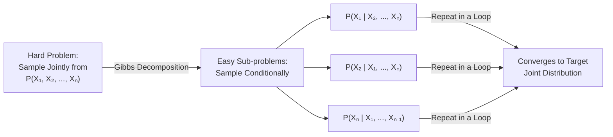
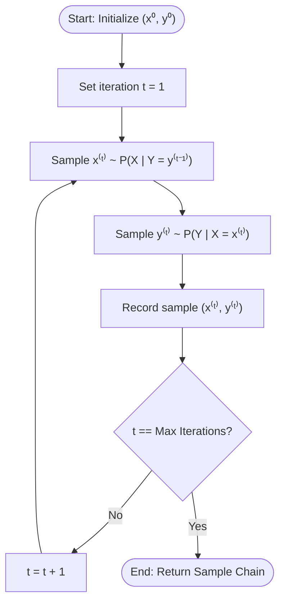
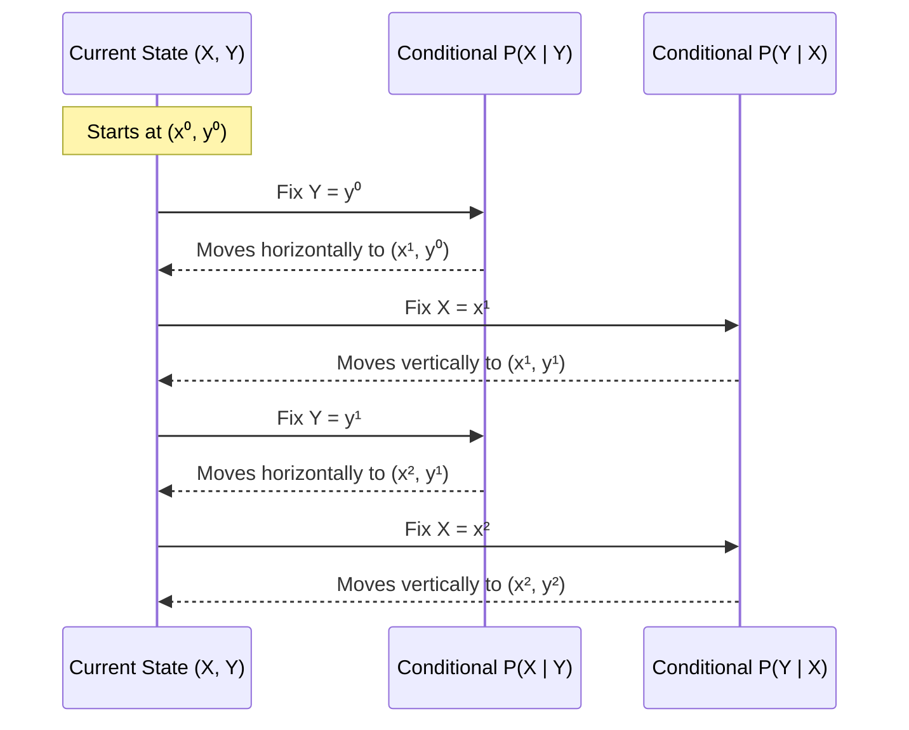
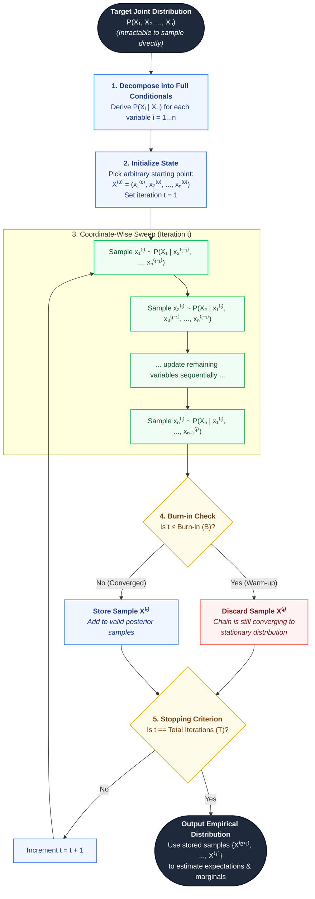
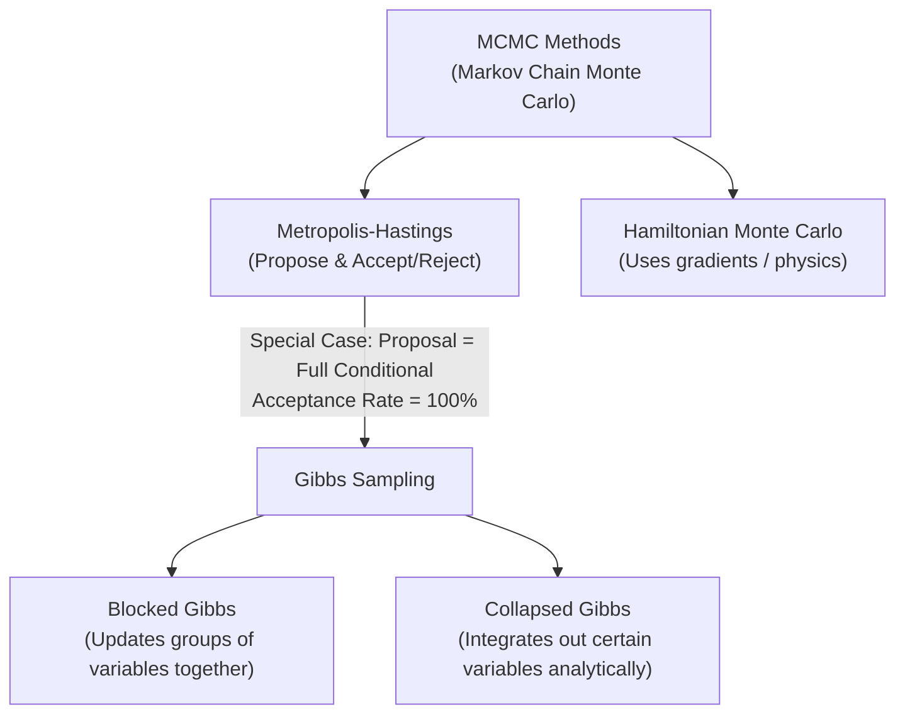
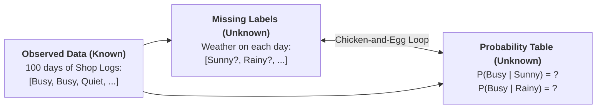
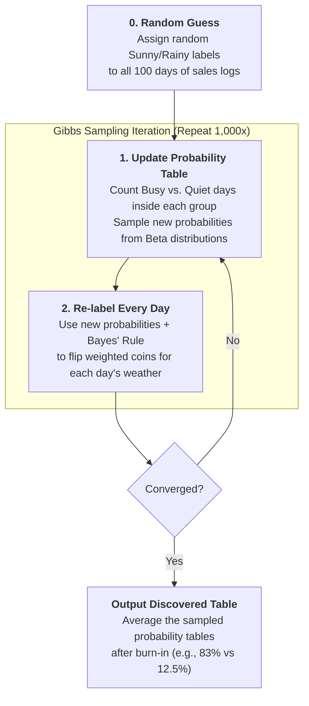

# Gibbs Sampling Explained

**Gibbs sampling** is a Markov Chain Monte Carlo (MCMC) algorithm used to draw samples from a complex, multi-dimensional probability distribution when direct sampling is difficult, by breaking the problem down into a sequence of simpler, one-dimensional conditional distributions.

---

## 1. The Core Problem & Intuition

Suppose you have a joint probability distribution over multiple variables, $P(X_1, X_2, \dots, X_n)$, and you want to generate random samples from it (for example, to estimate expected values or marginal distributions in Bayesian inference). 

* **The Problem:** Sampling from $P(X_1, X_2, \dots, X_n)$ all at once is often mathematically intractable because normalizing constants (integrals over high-dimensional spaces) are impossible to compute.
* **The Gibbs Solution:** Even if the joint distribution is hard to sample, the **full conditional distributions**—the distribution of one variable given fixed values for all the others, written as $P(X_i \mid X_{-i})$—are often easy to sample from. 

Instead of jumping straight to a point in $n$-dimensional space, Gibbs sampling takes coordinate-wise steps, updating one variable at a time while holding the others constant.

---

## 2. How the Algorithm Works

Let's trace a simple 2-variable case, $P(X, Y)$, to see the exact mechanics.

1. **Initialize:** Pick arbitrary starting values $(x^{(0)}, y^{(0)})$.
2. **Iterate:** For each step $t = 1, 2, \dots, T$:
   * Sample a new value for $X$ conditioned on the *current* value of $Y$: 
     $$x^{(t)} \sim P(X \mid Y = y^{(t-1)})$$
   * Sample a new value for $Y$ conditioned on the *newly updated* value of $X$: 
     $$y^{(t)} \sim P(Y \mid X = x^{(t)})$$
3. **Collect:** Save the pair $(x^{(t)}, y^{(t)})$ as a sample and repeat.

Notice that in step 2b, $Y$ immediately uses the brand-new $x^{(t)}$, not $x^{(t-1)}$.

---

## 3. The State-Space Trajectory (Orthogonal Moves)

Because Gibbs sampling updates one variable at a time, its movement through the probability space looks like a staircase or a Manhattan grid—it only ever moves parallel to the coordinate axes.

---

## 4. Practical Considerations in MCMC

To get reliable results from a Gibbs sampler, you cannot just blindly use every number it spits out. Two standard post-processing steps are required:

1. **Burn-in Period:** Because you start at an arbitrary guess $(x^{(0)}, y^{(0)})$, the early samples might be in a very low-probability region far from the true distribution. You discard the first $B$ samples (e.g., the first 1,000 iterations) to give the Markov chain time to "forget" its starting point and reach its stationary distribution.
2. **Thinning (Autocorrelation):** Because $(x^{(t)}, y^{(t)})$ is directly generated from $(x^{(t-1)}, y^{(t-1)})$, consecutive samples are correlated, not strictly independent. Sometimes practitioners keep only every $k$-th sample (thinning) if memory is constrained, though modern practice often keeps all post-burn-in samples and accounts for autocorrelation when computing standard errors.

```mermaid
gantt
    title Lifecycle of a Gibbs Sampling Chain
    dateFormat X
    axisFormat %s

    section Phase 1
    Burn-in (Discarded)           :crit, 0, 200
    section Phase 2
    Stationary Sampling (Kept)    :active, 200, 1000
```

---

## 5. End-to-End Architecture

Putting all components together—decomposition, initialization, sequential sweeps, burn-in filtering, and posterior estimation:

---

## 6. Strengths vs. Limitations

| Feature | Strengths | Limitations |
| :--- | :--- | :--- |
| **Tuning** | **Zero hyperparameters.** Unlike Metropolis-Hastings, you don't need to tune a proposal step size; every proposed sample is accepted (acceptance rate = 100%). | **Requires closed-form conditionals.** You must be able to mathematically derive and sample from every $P(X_i \mid X_{-i})$. |
| **High Dimensions** | Breaks a massive $N$-dimensional integral into $N$ simple 1D updates. | **Struggles with high correlation.** If $X$ and $Y$ are strongly correlated (a narrow diagonal ridge), taking only horizontal/vertical steps causes the sampler to crawl very slowly. |

---

## 7. Relationship to Metropolis-Hastings

Gibbs sampling is actually a **special case of the Metropolis-Hastings (MH) algorithm**. In MH, you propose a move and accept or reject it based on an acceptance probability $\alpha$. If you choose the full conditional distribution $P(X_i \mid X_{-i})$ as your MH proposal distribution, the math simplifies so that $\alpha = 1$ every single time.

## Simple Numerical Example: Weather & Ice Cream Sales

Imagine a small town where two things happen each day:
1. **Weather (W):** Either **Sunny (S)** or **Rainy (R)**.
2. **Ice Cream Shop (C):** Either **Busy (B)** or **Quiet (Q)**.

Suppose we know the joint probabilities of all 4 combinations over a year:

| | **Busy (B)** | **Quiet (Q)** | **Total Weather** |
| :--- | :---: | :---: | :---: |
| **Sunny (S)** | **0.50** (50%) | **0.10** (10%) | 0.60 (60%) |
| **Rainy (R)** | **0.05** (5%) | **0.35** (35%) | 0.40 (40%) |
| **Total Shop** | 0.55 (55%) | 0.45 (45%) | **1.00** |

**Goal:** Generate random simulated days $(W, C)$ that match this table by updating one variable at a time.

---

### Step 1: Find the 4 Simple Conditional Rules (Just Ratios!)

To sample one variable given the other, simply look at that row or column and take the ratio:

1. **If it is Sunny ($W = S$):** The row is `0.50` Busy vs. `0.10` Quiet (a 5-to-1 ratio).
   * $P(\text{Busy} \mid \text{Sunny}) = \frac{0.50}{0.50 + 0.10} = \frac{5}{6} \approx \mathbf{83\%}$
   * $P(\text{Quiet} \mid \text{Sunny}) = \frac{1}{6} \approx \mathbf{17\%}$

2. **If it is Rainy ($W = R$):** The row is `0.05` Busy vs. `0.35` Quiet (a 1-to-7 ratio).
   * $P(\text{Busy} \mid \text{Rainy}) = \frac{0.05}{0.05 + 0.35} = \frac{1}{8} = \mathbf{12.5\%}$
   * $P(\text{Quiet} \mid \text{Rainy}) = \frac{7}{8} = \mathbf{87.5\%}$

3. **If the shop is Busy ($C = B$):** The column is `0.50` Sunny vs. `0.05` Rainy (a 10-to-1 ratio).
   * $P(\text{Sunny} \mid \text{Busy}) = \frac{0.50}{0.50 + 0.05} = \frac{10}{11} \approx \mathbf{91\%}$
   * $P(\text{Rainy} \mid \text{Busy}) = \frac{1}{11} \approx \mathbf{9\%}$

4. **If the shop is Quiet ($C = Q$):** The column is `0.10` Sunny vs. `0.35` Rainy (a 2-to-7 ratio).
   * $P(\text{Sunny} \mid \text{Quiet}) = \frac{0.10}{0.10 + 0.35} = \frac{2}{9} \approx \mathbf{22\%}$
   * $P(\text{Rainy} \mid \text{Quiet}) = \frac{7}{9} \approx \mathbf{78\%}$

---

### Step 2: Simulate 3 Days by Drawing Random Numbers (1–100)

Let's start with an unlikely combination: **Day 0 = (Rainy, Busy)**.

#### **Day 1**
1. **Update Weather (given Shop = Busy):**
   * Rule 3 says there is a **91% chance of Sunny** and **9% chance of Rainy**.
   * Draw a random number from 1 to 100 and get `34` ($\le 91$).
   * New Weather = **Sunny**.
2. **Update Shop (given the new Weather = Sunny):**
   * Rule 1 says there is an **83% chance of Busy** and **17% chance of Quiet**.
   * Draw a random number from 1 to 100 and get `62` ($\le 83$).
   * New Shop = **Busy**.
* **Simulated Day 1:** **(Sunny, Busy)**

#### **Day 2**
1. **Update Weather (given Shop = Busy):**
   * Rule 3: **91% Sunny** vs. **9% Rainy**.
   * Random draw = `95` ($> 91$).
   * New Weather = **Rainy**.
2. **Update Shop (given the new Weather = Rainy):**
   * Rule 2 says there is a **12.5% chance of Busy** and **87.5% chance of Quiet**.
   * Random draw = `48` ($> 12.5$).
   * New Shop = **Quiet**.
* **Simulated Day 2:** **(Rainy, Quiet)**

#### **Day 3**
1. **Update Weather (given Shop = Quiet):**
   * Rule 4: **22% Sunny** vs. **78% Rainy**.
   * Random draw = `71` ($> 22$).
   * New Weather = **Rainy**.
2. **Update Shop (given Weather = Rainy):**
   * Rule 2: **12.5% Busy** vs. **87.5% Quiet**.
   * Random draw = `19` ($> 12.5$).
   * New Shop = **Quiet**.
* **Simulated Day 3:** **(Rainy, Quiet)**

---

### Step 3: Visual Flow of the 3 Days

```mermaid
flowchart LR
    D0["<b>Day 0 (Start)</b><br>(Rainy, Busy)"] -->|"Shop = Busy<br>(91% Sunny)"| D0_5["(Sunny, Busy)"]
    D0_5 -->|"Weather = Sunny<br>(83% Busy)"| D1["<b>Day 1</b><br>(Sunny, Busy)"]
    D1 -->|"Shop = Busy<br>(9% Rainy)"| D1_5["(Rainy, Busy)"]
    D1_5 -->|"Weather = Rainy<br>(87.5% Quiet)"| D2["<b>Day 2</b><br>(Rainy, Quiet)"]
    D2 -->|"Shop = Quiet<br>(78% Rainy)"| D2_5["(Rainy, Quiet)"]
    D2_5 -->|"Weather = Rainy<br>(87.5% Quiet)"| D3["<b>Day 3</b><br>(Rainy, Quiet)"]
```

### Why This Works
If you repeat this game 10,000 times and count your simulated days:
* About **5,000 days (50%)** will be *(Sunny, Busy)*
* About **1,000 days (10%)** will be *(Sunny, Quiet)*
* About **500 days (5%)** will be *(Rainy, Busy)*
* About **3,500 days (35%)** will be *(Rainy, Quiet)*

Even though you only ever flipped weighted coins for **one variable at a time**, the pairs naturally settle into the exact proportions of the original 2D table.

## How Gibbs Sampling Solves a Problem When the Table Isn't Known Upfront

When the probability table is unknown upfront, **Gibbs sampling solves the inverse problem (Bayesian inference) by alternating between guessing the missing labels for your data and updating the unknown probabilities based on those guesses.**

Instead of knowing the probabilities and generating data, you have **real-world data with missing information** (latent variables) and **unknown rules** (parameters), and Gibbs sampling discovers both simultaneously.

---

### 1. The Real-World Problem: Hidden Causes

Imagine you are the manager of a newly opened ice cream shop, and you don't know the town's probability table yet. You have 100 days of sales logs (**Busy** or **Quiet**), and you know there are two hidden weather patterns (**Sunny** or **Rainy**), *but your historical log forgot to record the weather!*

You have two unknowns that depend on each other:
1. **Missing Labels ($Z$):** Was Day 1 Sunny or Rainy? What about Day 2?
2. **Unknown Probabilities ($\theta$):** What is the true chance of being Busy on a Sunny day vs. a Rainy day?

* If you knew the **Probability Table**, you could easily guess the **Weather** for each day.
* If you knew the **Weather** for each day, you could easily count the rows and calculate the **Probability Table**.

Gibbs sampling breaks this chicken-and-egg deadlock by starting with a random guess and alternating between the two.

---

### 2. How Gibbs Sampling Discovers the Table

#### **Step 0: Random Initialization**
Since you know nothing, flip a fair coin to randomly assign **Sunny** or **Rainy** to every single day in your 100-day log. (At first, these labels are pure noise.)

#### **Step 1: Sample the Unknown Probabilities ($\theta \mid \text{Data}, Z$)**
Pretend your current weather labels are true, and simply **count**:
* Out of the days currently labeled *Sunny*, say 32 were *Busy* and 18 were *Quiet*.
* Instead of taking a rigid ratio, Gibbs sampling draws a random probability from a **Beta distribution** centered around that ratio (e.g., $\text{Beta}(32+1, 18+1)$), which might give **$P(\text{Busy} \mid \text{Sunny}) = 65\%$**.
* Do the same for *Rainy* days, say giving **$P(\text{Busy} \mid \text{Rainy}) = 20\%$**.

#### **Step 2: Re-Sample the Missing Labels ($Z \mid \text{Data}, \theta$)**
Now use those newly updated probabilities to re-guess the weather for each day one by one using **Bayes' Rule**:
* Look at **Day 1**, where the shop was **Busy**.
* Since *Busy* happens **65%** of the time on Sunny days vs. only **20%** on Rainy days, Day 1 is much more likely to have been Sunny ($\frac{65}{65+20} \approx \mathbf{76\%}$ chance of Sunny).
* Flip a weighted coin (76% Sunny / 24% Rainy) to assign a fresh weather label to Day 1. Repeat for all 100 days.

#### **Step 3: Repeat 1,000 Times**
Every time you repeat Steps 1 and 2, the noise cancels out:
* Days that were *Busy* cluster together under one label, pushing its Busy probability up toward the true **83%**.
* Days that were *Quiet* cluster together under the other label, pushing its Busy probability down toward the true **12.5%**.

---

### 3. Why This Is Used Everywhere in AI & Data Science

This exact pattern—**inferring unknown labels and unknown probabilities from raw data**—is how real-world machine learning models work when the ground truth isn't given:

| Application | Observed Data (Known) | Missing Labels ($Z$) | Unknown Table ($\theta$) |
| :--- | :--- | :--- | :--- |
| **Topic Modeling (LDA)** | Thousands of news articles | Which topic each word belongs to | Word probabilities per topic (e.g., *"goal"* = 5% in Sports) |
| **Customer Segmentation** | Purchase histories | Which persona each shopper belongs to | Buying habits of each customer segment |
| **Genetics / Population Structure** | DNA sequences of individuals | Ancestral population of each gene | Allele frequencies in each ancestral group |
