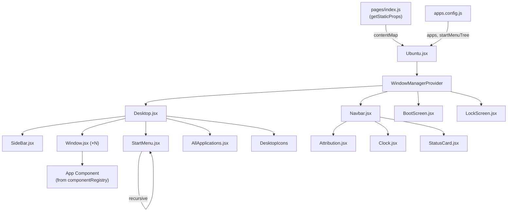
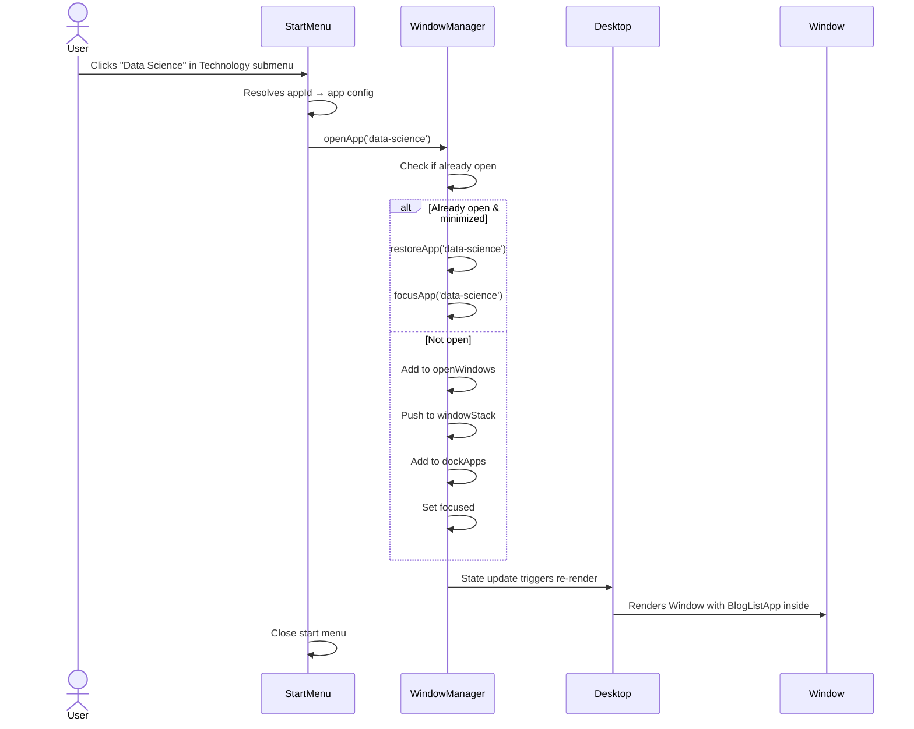
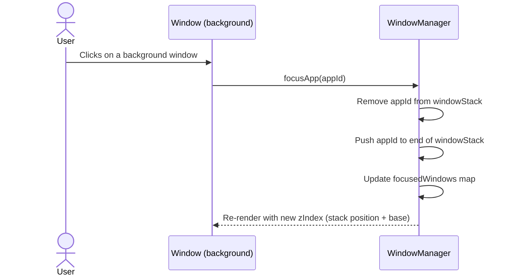

# Ubuntu Portfolio — Architecture & Design Document

> **Project**: Personal portfolio website simulating an Ubuntu 26.04.1 LTS desktop environment  
> **Stack**: Next.js 14 (Pages Router), React 18, Tailwind CSS 3  
> **Deployment**: Static export → GitHub Pages (`username.github.io`)  
> **Inspiration**: [vivek9patel/vivek9patel.github.io](https://github.com/vivek9patel/vivek9patel.github.io)

---

## 1. System Overview

The application simulates a complete Ubuntu desktop environment in the browser. Visitors interact with a desktop metaphor — opening, dragging, minimizing, and closing windows — to explore portfolio content. Blog posts are authored as Markdown files and rendered statically at build time.

### 1.1 Core User Journey

```
Boot Screen → Lock Screen → Desktop
                                ├── Top Navbar (status bar, clock, power menu)
                                ├── Side Dock (favourite/open app icons)
                                ├── Desktop Icons (double-click to open)
                                ├── Application Launcher (grid view + search)
                                ├── Start Menu (hierarchical nested menus)
                                └── Draggable, resizable windows
```

### 1.2 Key Design Decisions

| Decision | Rationale |
|---|---|
| **Pages Router** (not App Router) | Simpler static export; single-page app with no server components needed |
| **Tailwind CSS 3** | Requested by user; matches original repo |
| **React Context** (not Redux) | Lightweight; no async data fetching; all state is UI state |
| **Markdown → Static HTML** at build time | GitHub Pages serves only static files; no runtime API |
| **Hierarchical config object** (not flat array) | Supports nested submenu system for Start Menu |

---

## 2. Directory Structure

```
Strider221B.github.io/
├── apps.config.js                  # Central app/menu configuration
├── content/                        # Markdown blog content
│   ├── about-me/
│   │   └── index.md
│   ├── data-science/
│   │   ├── post-1.md
│   │   └── post-2.md
│   ├── ai-engineering/
│   │   ├── post-1.md
│   │   └── post-2.md
│   ├── programming/
│   │   ├── post-1.md
│   │   └── post-2.md
│   └── psychology/
│       ├── post-1.md
│       └── post-2.md
├── components/
│   ├── apps/                       # Individual application components
│   │   ├── Terminal.jsx
│   │   ├── Settings.jsx
│   │   ├── Trash.jsx
│   │   ├── MarkdownViewer.jsx      # Renders markdown content in a window
│   │   └── BlogListApp.jsx         # Lists blog posts for a topic category
│   ├── base/                       # Reusable window primitives
│   │   ├── Window.jsx              # Draggable, resizable window shell
│   │   ├── WindowTitleBar.jsx
│   │   ├── WindowControls.jsx      # Minimize / Maximize / Close buttons
│   │   └── SideBarApp.jsx          # Single dock icon
│   ├── screen/                     # Full-screen layout sections
│   │   ├── BootScreen.jsx
│   │   ├── LockScreen.jsx
│   │   ├── Desktop.jsx             # Main desktop surface + window manager
│   │   ├── Navbar.jsx              # Top status bar
│   │   ├── SideBar.jsx             # Left application dock
│   │   ├── StartMenu.jsx           # Hierarchical nested menu overlay
│   │   └── AllApplications.jsx     # Grid launcher view
│   ├── seo/
│   │   └── Meta.jsx
│   ├── util/
│   │   ├── Clock.jsx
│   │   ├── StatusIcons.jsx
│   │   ├── StatusCard.jsx
│   │   └── Attribution.jsx         # "Inspired by vivek9patel" footer element
│   └── Ubuntu.jsx                  # Root orchestrator component
├── context/
│   └── WindowManagerContext.jsx    # React Context for window state
├── hooks/
│   ├── useWindowManager.js         # Window open/close/minimize/maximize/focus logic
│   └── useMarkdownLoader.js        # Loads pre-built markdown content
├── lib/
│   ├── markdown.js                 # Build-time markdown parsing utilities
│   ├── constants.js                # Shared constants (colors, z-index bases, etc.)
│   └── componentRegistry.js        # Maps config component keys → React components
├── pages/
│   ├── _app.js                     # Global layout, Tailwind import
│   ├── _document.js                # Custom HTML document (fonts, meta)
│   └── index.js                    # Single page — renders <Ubuntu />
├── public/
│   ├── themes/
│   │   └── Yaru/                   # Ubuntu Yaru icon theme assets
│   │       ├── apps/               # App icons (terminal, settings, folder, etc.)
│   │       ├── system/             # System icons (trash, user-home, grid, etc.)
│   │       └── window/             # Window control icons (close, min, max, restore)
│   ├── wallpapers/                 # Desktop wallpaper images
│   ├── images/
│   │   └── logos/                  # Search icon, Ubuntu logo, etc.
│   └── .nojekyll                   # Tells GitHub Pages to skip Jekyll processing
├── styles/
│   └── globals.css                 # Tailwind directives + custom Ubuntu CSS
├── next.config.js                  # Static export configuration
├── tailwind.config.js              # Ubuntu color palette + custom utilities
├── postcss.config.js
├── package.json
└── documentation/
    └── design/
        └── 01_architecture_overview.md   # ← This file
```

---

## 3. App Configuration System

### 3.1 `apps.config.js` — Central Configuration

This is the **single source of truth** for all applications, menus, desktop shortcuts, and dock items. It supports a **hierarchical tree structure** for the Start Menu.

```javascript
// apps.config.js

// ─── APP TYPE CONSTANTS ─────────────────────────────────────────────
export const APP_TYPES = {
  WINDOW: 'window',         // Opens a windowed application
  FOLDER: 'folder',         // Start menu category (has children)
  EXTERNAL: 'external',     // Opens an external URL
};

// ─── APP REGISTRY ───────────────────────────────────────────────────
// Each app object defines a launchable application.
// The `component` field is a string key that maps to a component
// in the component registry (see Section 3.2).

const apps = [
  // ── Core System Apps ──────────────────────────────────────────
  {
    id: 'terminal',
    title: 'Terminal',
    icon: '/themes/Yaru/apps/bash.png',
    type: APP_TYPES.WINDOW,
    component: 'Terminal',
    favourite: true,
    desktop_shortcut: true,
    desktop_order: 2,
    disabled: false,
  },
  {
    id: 'settings',
    title: 'Settings',
    icon: '/themes/Yaru/apps/gnome-control-center.png',
    type: APP_TYPES.WINDOW,
    component: 'Settings',
    favourite: true,
    desktop_shortcut: false,
    disabled: false,
  },
  {
    id: 'trash',
    title: 'Trash',
    icon: '/themes/Yaru/system/user-trash-full.png',
    type: APP_TYPES.WINDOW,
    component: 'Trash',
    favourite: false,
    desktop_shortcut: true,
    desktop_order: 3,
    disabled: false,
  },

  // ── Content Apps ──────────────────────────────────────────────
  {
    id: 'about-me',
    title: 'About Me',
    icon: '/themes/Yaru/system/user-home.png',
    type: APP_TYPES.WINDOW,
    component: 'MarkdownViewer',
    componentProps: { contentPath: 'about-me' },
    favourite: true,
    desktop_shortcut: true,
    desktop_order: 1,
    disabled: false,
  },
  {
    id: 'data-science',
    title: 'Data Science',
    icon: '/themes/Yaru/apps/accessories-calculator.png',
    type: APP_TYPES.WINDOW,
    component: 'BlogListApp',
    componentProps: { category: 'data-science' },
    favourite: false,
    desktop_shortcut: false,
    disabled: false,
  },
  {
    id: 'ai-engineering',
    title: 'AI Engineering',
    icon: '/themes/Yaru/apps/accessories-calculator.png',
    type: APP_TYPES.WINDOW,
    component: 'BlogListApp',
    componentProps: { category: 'ai-engineering' },
    favourite: false,
    desktop_shortcut: false,
    disabled: false,
  },
  {
    id: 'programming',
    title: 'Programming',
    icon: '/themes/Yaru/apps/vscode.png',
    type: APP_TYPES.WINDOW,
    component: 'BlogListApp',
    componentProps: { category: 'programming' },
    favourite: false,
    desktop_shortcut: false,
    disabled: false,
  },
  {
    id: 'psychology',
    title: 'Psychology',
    icon: '/themes/Yaru/apps/gedit.png',
    type: APP_TYPES.WINDOW,
    component: 'BlogListApp',
    componentProps: { category: 'psychology' },
    favourite: false,
    desktop_shortcut: false,
    disabled: false,
  },
];

// ─── START MENU HIERARCHY ───────────────────────────────────────────
// Defines the nested menu structure. Each node is either:
//   - { appId: 'xxx' }              → links to an app from the registry
//   - { label, icon, children: [] } → folder containing sub-items
//
// To add a new menu item: just append to the appropriate `children` array.
// To add a new submenu:   add a new folder node with its own `children`.

export const startMenuTree = [
  { appId: 'about-me' },
  {
    label: 'Technology',
    icon: '/themes/Yaru/apps/folder.png',
    children: [
      { appId: 'data-science' },
      { appId: 'ai-engineering' },
      { appId: 'programming' },
    ],
  },
  { appId: 'psychology' },
  { type: 'separator' },
  { appId: 'terminal' },
  { appId: 'settings' },
  { appId: 'trash' },
];

// ─── HELPER FUNCTIONS ───────────────────────────────────────────────

/** Look up an app config by its id. */
export function getAppById(id) {
  return apps.find((app) => app.id === id) || null;
}

/** Get all apps marked as desktop shortcuts. */
export function getDesktopApps() {
  return apps
    .filter((app) => app.desktop_shortcut && !app.disabled)
    .sort((a, b) => (a.desktop_order ?? Infinity) - (b.desktop_order ?? Infinity));
}

/** Get all apps marked as dock favourites. */
export function getFavouriteApps() {
  return apps.filter((app) => app.favourite && !app.disabled);
}

export default apps;
```

### 3.2 Component Registry

A separate registry maps the string `component` keys in the config to actual React components. This avoids circular imports and keeps the config file pure data.

```javascript
// lib/componentRegistry.js

import dynamic from 'next/dynamic';

const componentRegistry = {
  Terminal:       dynamic(() => import('../components/apps/Terminal'), { ssr: false }),
  Settings:      dynamic(() => import('../components/apps/Settings'), { ssr: false }),
  Trash:         dynamic(() => import('../components/apps/Trash'), { ssr: false }),
  MarkdownViewer: dynamic(() => import('../components/apps/MarkdownViewer'), { ssr: false }),
  BlogListApp:   dynamic(() => import('../components/apps/BlogListApp'), { ssr: false }),
};

export function getComponent(name) {
  return componentRegistry[name] || null;
}

export default componentRegistry;
```

### 3.3 Adding a New App (Workflow)

To add a new app, a developer only needs to:

1. **Create the component** in `components/apps/MyNewApp.jsx`
2. **Register it** in `lib/componentRegistry.js`: add `MyNewApp: dynamic(() => import(...))`
3. **Add an entry** in `apps.config.js` → the `apps` array
4. **Place it in the Start Menu** → add `{ appId: 'my-new-app' }` to `startMenuTree`

No other files need modification.

---

## 4. Window State Management

### 4.1 State Shape

All window state is managed through React Context + a custom hook.

```javascript
// The shape of the window manager state:
{
  // Map of appId → boolean. True = the window is currently open (rendered in DOM).
  openWindows: { 'terminal': true, 'about-me': true },

  // Map of appId → boolean. True = currently minimized (hidden but still "open").
  minimizedWindows: { 'terminal': false, 'about-me': true },

  // Map of appId → boolean. True = currently maximized (fills viewport).
  maximizedWindows: { 'terminal': false, 'about-me': false },

  // Map of appId → boolean. True = this window currently has input focus.
  focusedWindows: { 'terminal': true, 'about-me': false },

  // Ordered stack of appIds. Last element = topmost window (highest z-index).
  // Used to compute z-index: base_z + indexOf(appId).
  windowStack: ['about-me', 'terminal'],

  // Map of appId → boolean. True = app icon shows in the dock.
  dockApps: { 'terminal': true, 'settings': true, 'about-me': true },
}
```

### 4.2 Context & Hook Architecture

```
┌─────────────────────────────────────────────────┐
│  WindowManagerContext.jsx                       │
│  ┌───────────────────────────────────────────┐  │
│  │  WindowManagerProvider                    │  │
│  │  - Holds all state via useReducer         │  │
│  │  - Exposes state + dispatch via Context   │  │
│  └───────────────────────────────────────────┘  │
└─────────────────────────────────────────────────┘
                      │
                      ▼
┌─────────────────────────────────────────────────┐
│  useWindowManager.js (custom hook)              │
│  - openApp(appId)                               │
│  - closeApp(appId)                              │
│  - minimizeApp(appId)                           │
│  - maximizeApp(appId) / restoreApp(appId)       │
│  - focusApp(appId)                              │
│  - isOpen(appId), isMinimized(appId), etc.      │
│  - getZIndex(appId)                             │
└─────────────────────────────────────────────────┘
                      │
          ┌───────────┼───────────┐
          ▼           ▼           ▼
     Desktop.jsx  SideBar.jsx  Window.jsx
```

### 4.3 Reducer Actions

```javascript
const ACTIONS = {
  OPEN_APP: 'OPEN_APP',           // Add to openWindows, push to windowStack, focus
  CLOSE_APP: 'CLOSE_APP',         // Remove from openWindows, remove from stack
  MINIMIZE_APP: 'MINIMIZE_APP',   // Set minimized=true, focus next in stack
  RESTORE_APP: 'RESTORE_APP',     // Set minimized=false, focus
  MAXIMIZE_APP: 'MAXIMIZE_APP',   // Set maximized=true
  UNMAXIMIZE_APP: 'UNMAXIMIZE_APP',
  FOCUS_APP: 'FOCUS_APP',         // Move to top of windowStack, set focused
  ADD_TO_DOCK: 'ADD_TO_DOCK',
  REMOVE_FROM_DOCK: 'REMOVE_FROM_DOCK',
};
```

### 4.4 Z-Index Strategy

```
Z_INDEX_BASE = 20

getZIndex(appId):
  index = windowStack.indexOf(appId)
  if index === -1: return Z_INDEX_BASE
  return Z_INDEX_BASE + index + 1

// The focused/topmost window always has the highest z-index.
// Navbar and overlays use z-50+ to stay above all windows.
```

### 4.5 Desktop Icon Double-Click

Desktop icons use an `onDoubleClick` handler that calls `openApp(appId)`. If the app is already open but minimized, `openApp` restores and focuses it instead of creating a duplicate.

```jsx
// Inside Desktop.jsx
{getDesktopApps().map((app) => (
  <DesktopIcon
    key={app.id}
    icon={app.icon}
    title={app.title}
    onDoubleClick={() => openApp(app.id)}
  />
))}
```

---

## 5. Start Menu — Hierarchical Nested Submenus

### 5.1 Data Flow

```
startMenuTree (apps.config.js)
        │
        ▼
  StartMenu.jsx
  ├── Renders top-level items
  ├── For folder nodes → renders a clickable row with "▸" chevron
  │   └── On hover/click → renders StartMenuSubmenu with children
  │       └── Recursively handles nested folders
  └── For app nodes → resolves appId via getAppById()
      └── On click → calls openApp(appId) and closes menu
```

### 5.2 Recursive Rendering

```jsx
// StartMenu.jsx — simplified pseudocode
function StartMenuItem({ item, depth }) {
  if (item.type === 'separator') return <hr />;

  if (item.children) {
    // This is a folder — render with submenu
    return (
      <div className="menu-folder" onMouseEnter={showSubmenu}>
        
        <span>{item.label}</span>
        <span className="chevron">▸</span>
        {isSubmenuOpen && (
          <div className="submenu" style={{ left: '100%' }}>
            {item.children.map((child, i) => (
              <StartMenuItem key={i} item={child} depth={depth + 1} />
            ))}
          </div>
        )}
      </div>
    );
  }

  // This is a leaf app node
  const app = getAppById(item.appId);
  return (
    <div className="menu-item" onClick={() => openApp(app.id)}>
      
      <span>{app.title}</span>
    </div>
  );
}
```

---

## 6. Markdown Blog System

### 6.1 Build-Time Content Pipeline

Since GitHub Pages only serves static files, all markdown is processed at build time using Next.js `getStaticProps`.

```
content/data-science/post-1.md
        │
        ▼ (at build time)
  lib/markdown.js
  ├── gray-matter → parses frontmatter (title, date, tags)
  ├── remark + remark-html → converts MD body to HTML string
  └── Returns { slug, frontmatter, htmlContent }
        │
        ▼
  pages/index.js getStaticProps()
  └── Reads all content dirs, builds a map:
      {
        'data-science': [{ slug, title, date, excerpt, htmlContent }, ...],
        'ai-engineering': [...],
        ...
      }
        │
        ▼ (passed as page props)
  <Ubuntu contentMap={contentMap} />
  └── BlogListApp receives contentMap[category]
      └── On post click → opens MarkdownViewer window with htmlContent
```

### 6.2 Markdown Frontmatter Schema

```yaml
---
title: "Building a Neural Network from Scratch"
date: "2024-03-15"
tags: ["python", "deep-learning"]
excerpt: "A walkthrough of implementing backpropagation..."
---

# Content starts here...
```

### 6.3 Blog Post Rendering Flow

```
BlogListApp (category window)
├── Shows list of posts with title, date, excerpt
├── On post click:
│   └── Calls openApp() with a dynamic id like 'post-data-science-post-1'
│       └── Opens MarkdownViewer window with the post's HTML content
└── Sorted by date descending
```

---

## 7. Component Specifications

### 7.1 Ubuntu.jsx — Root Orchestrator

**Responsibilities:**
- Manages top-level screen state (booting, locked, desktop)
- Wraps everything in `WindowManagerProvider`
- Passes background image state to Desktop

**State:**
```javascript
{
  isBooting: boolean,       // Show boot animation
  isLocked: boolean,        // Show lock screen
  isShutDown: boolean,      // Show black screen with power button
  backgroundImage: string,  // Current wallpaper filename
}
```

### 7.2 Window.jsx — Window Shell

**Responsibilities:**
- Renders a draggable, resizable window frame
- Delegates to `WindowTitleBar` and `WindowControls`
- Renders the app component inside the window body
- Reports minimize/maximize/close/focus events to WindowManager

**Props:**
```typescript
{
  appId: string,
  title: string,
  icon: string,
  children: ReactNode,      // The app component rendered inside
  isFocused: boolean,
  isMinimized: boolean,
  isMaximized: boolean,
  zIndex: number,
  onClose: () => void,
  onMinimize: () => void,
  onMaximize: () => void,
  onFocus: () => void,
}
```

### 7.3 Desktop.jsx — Desktop Surface

**Responsibilities:**
- Renders background wallpaper
- Renders desktop shortcut icons (from config)
- Renders all open `Window` components
- Renders `SideBar`, `StartMenu`, `AllApplications` overlay
- Handles right-click context menus

### 7.4 Navbar.jsx — Top Status Bar

**Layout:**
```
┌─────────────────────────────────────────────────────────────────┐
│  Activities                    Oct 10, 2026 8:18 AM       🔊 ⚡ │
│                                                    ┌──────────┐│
│                                                    │StatusCard ││
│                                                    │ Lock      ││
│                                                    │ Shut Down ││
│                                                    └──────────┘│
└─────────────────────────────────────────────────────────────────┘
```

### 7.5 Attribution.jsx

A small, elegant text element in the bottom-right of the Navbar or as an overlay on the desktop:

```jsx
// components/util/Attribution.jsx
export default function Attribution() {
  return (
    <a
      href="https://github.com/vivek9patel/vivek9patel.github.io"
      target="_blank"
      rel="noopener noreferrer"
      className="fixed bottom-1 right-2 text-xs text-white/40 hover:text-white/70
                 transition-colors z-50 select-none"
    >
      Inspired by vivek9patel&apos;s Ubuntu Simulation
    </a>
  );
}
```

---

## 8. Next.js Static Export Configuration

### 8.1 `next.config.js`

```javascript
/** @type {import('next').NextConfig} */
const nextConfig = {
  // ── Static Export ─────────────────────────────────────────────
  output: 'export',

  // ── Asset Handling ────────────────────────────────────────────
  // For username.github.io (root deployment), no prefix needed.
  // For project pages (username.github.io/repo-name), set:
  //   basePath: '/repo-name',
  //   assetPrefix: '/repo-name/',
  basePath: '',
  assetPrefix: '',

  // ── Trailing Slashes ─────────────────────────────────────────
  // GitHub Pages expects trailing slashes for directory-style URLs.
  trailingSlash: true,

  // ── Image Optimization ────────────────────────────────────────
  // Next.js Image Optimization requires a server. Disable for static export.
  images: {
    unoptimized: true,
  },

  // ── Environment Variables ─────────────────────────────────────
  env: {
    NEXT_PUBLIC_SITE_URL: 'https://strider221b.github.io',
  },
};

module.exports = nextConfig;
```

### 8.2 `package.json` Scripts

```json
{
  "name": "strider221b-portfolio",
  "version": "1.0.0",
  "private": true,
  "homepage": "https://strider221b.github.io/",
  "scripts": {
    "dev": "next dev",
    "build": "next build",
    "start": "next start",
    "export": "next build",
    "deploy": "next build && touch out/.nojekyll && gh-pages -d out -t true"
  },
  "engines": {
    "node": ">=18.x"
  },
  "dependencies": {
    "next": "^14.2.0",
    "react": "^18.3.0",
    "react-dom": "^18.3.0",
    "react-draggable": "^4.4.6",
    "gray-matter": "^4.0.3",
    "remark": "^15.0.0",
    "remark-html": "^16.0.0",
    "tailwindcss": "^3.4.0",
    "autoprefixer": "^10.4.0",
    "postcss": "^8.4.0"
  },
  "devDependencies": {
    "gh-pages": "^6.1.0"
  }
}
```

> **Note**: With `output: 'export'` in Next.js 14, `next build` automatically produces the `out/` directory. The separate `next export` command is deprecated.

### 8.3 `.nojekyll`

Place an empty `.nojekyll` file in `public/` so it gets copied to `out/` during build. This prevents GitHub Pages from processing the site with Jekyll (which ignores `_next/` directories).

### 8.4 GitHub Actions Deployment (Optional)

```yaml
# .github/workflows/deploy.yml
name: Deploy to GitHub Pages

on:
  push:
    branches: [main]

permissions:
  contents: read
  pages: write
  id-token: write

jobs:
  build-and-deploy:
    runs-on: ubuntu-latest
    steps:
      - uses: actions/checkout@v5

      - uses: actions/setup-node@v5
        with:
          node-version: '24'
          cache: 'npm'

      - run: npm ci
      - run: npm run build

      - uses: actions/upload-pages-artifact@v5
        with:
          path: ./out

      - uses: actions/deploy-pages@v5
```

---

## 9. Tailwind CSS Configuration

### 9.1 `tailwind.config.js`

```javascript
/** @type {import('tailwindcss').Config} */
module.exports = {
  content: [
    './pages/**/*.{js,jsx}',
    './components/**/*.{js,jsx}',
  ],
  theme: {
    extend: {
      colors: {
        // Ubuntu palette
        'ub-grey': '#111111',
        'ub-warm-grey': '#AEA79F',
        'ub-cool-grey': '#333333',
        'ub-orange': '#E95420',
        'ub-lite-abrgn': '#77216F',
        'ub-med-abrgn': '#5E2750',
        'ub-drk-abrgn': '#2C001E',
        'ub-window-title': '#201f1f',
        'ub-gedit-dark': '#021B33',
        'ub-gedit-light': '#003B70',
        'ub-gedit-darker': '#010D1A',

        // Text variants
        'ubt-grey': '#F6F6F5',
        'ubt-warm-grey': '#AEA79F',
        'ubt-cool-grey': '#333333',
        'ubt-blue': '#3465A4',
        'ubt-green': '#4E9A06',
        'ubt-gedit-orange': '#F39A21',
        'ubt-gedit-blue': '#50B6C6',

        // Border
        'ubb-orange': '#E95420',
      },
      minWidth: {
        '1/4': '25%',
        '1/2': '50%',
        '3/4': '75%',
      },
      minHeight: {
        '1/4': '25%',
        '1/2': '50%',
        '3/4': '75%',
      },
      fontFamily: {
        ubuntu: ['Ubuntu', 'sans-serif'],
      },
      zIndex: {
        '-10': '-10',
        '60': '60',
      },
    },
  },
  plugins: [],
};
```

### 9.2 `styles/globals.css`

```css
@tailwind base;
@tailwind components;
@tailwind utilities;

@import url('https://fonts.googleapis.com/css2?family=Ubuntu:wght@300;400;500;700&display=swap');

body {
  font-family: 'Ubuntu', sans-serif;
  overflow: hidden;
  margin: 0;
  padding: 0;
}

/* ── Window Animations ─────────────────────────────────────── */
.closed-window {
  animation: closeWindow 200ms 1 forwards;
}

@keyframes closeWindow {
  0% {
    opacity: 1;
    transform: translate(var(--window-transform-x), var(--window-transform-y)) scale(1);
  }
  100% {
    opacity: 0;
    transform: translate(var(--window-transform-x), var(--window-transform-y)) scale(0.85);
    visibility: hidden;
  }
}

/* ── Window Shadow ─────────────────────────────────────────── */
.window-shadow {
  box-shadow: 1px 4px 12px 4px rgba(0, 0, 0, 0.2);
}

/* ── Unfocused Window ──────────────────────────────────────── */
.notFocused {
  filter: brightness(90%);
}

/* ── Scrollbar Styling ─────────────────────────────────────── */
.windowMainScreen::-webkit-scrollbar-track { background-color: transparent; }
.windowMainScreen::-webkit-scrollbar { width: 6px; background-color: transparent; }
.windowMainScreen::-webkit-scrollbar-thumb {
  background-color: #D3D7CF;
  border-radius: 5px;
}

/* ── Context Menu ──────────────────────────────────────────── */
.context-menu-bg { background-color: rgb(43, 43, 43); }

/* ── Start Menu ────────────────────────────────────────────── */
.start-menu-item:hover { background-color: rgba(255, 255, 255, 0.1); }
.start-menu-separator { border-top: 1px solid rgba(255, 255, 255, 0.15); margin: 4px 8px; }
```

---

## 10. Component Data Flow Diagram



---

## 11. Key Interactions — Sequence Diagrams

### 11.1 Opening an App from Start Menu



### 11.2 Window Focus (Z-Index Reordering)



---

## 12. Adapting Coding Standards for Frontend

The existing coding_standards.md is Python-focused. The following adaptations apply for the Next.js/React frontend code:

| Python Standard | Frontend Adaptation |
|---|---|
| Strict OOP / One class per file | One **component** per file. Functional components preferred. File name matches component name. |
| `__init__` constructor | `useState` / `useReducer` for state initialization |
| Private methods (`__method`) | Internal helper functions within the component file, not exported |
| Type hints | JSDoc comments on props interfaces; optional PropTypes |
| pytest | Jest + React Testing Library (future) |
| ruff / mypy | ESLint + Prettier (future) |
| Method ≤ 20 lines | Component render logic ≤ 50 JSX lines; extract sub-components beyond that |
| File ≤ 500 lines | **Same** — max 500 lines per file |
| No magic strings | Constants in `lib/constants.js` and `apps.config.js` |
| DRY | Extract shared UI into `components/base/` |
| YAGNI | Build only what the current design requires |

---

## 13. File Listing — Implementation Order

The recommended implementation order, building foundation → features:

| Phase | Files | Purpose |
|---|---|---|
| **1. Scaffold** | `package.json`, `next.config.js`, `tailwind.config.js`, `postcss.config.js`, `styles/globals.css`, `public/.nojekyll` | Project setup, build configuration |
| **2. Config** | `apps.config.js`, `lib/componentRegistry.js`, `lib/constants.js` | App registry, component mapping |
| **3. State** | `context/WindowManagerContext.jsx`, `hooks/useWindowManager.js` | Window management core |
| **4. Chrome** | `pages/_app.js`, `pages/_document.js`, `pages/index.js`, `components/Ubuntu.jsx` | Page shell, root component |
| **5. Layout** | `components/screen/Navbar.jsx`, `components/screen/SideBar.jsx`, `components/screen/Desktop.jsx` | Desktop chrome |
| **6. Windows** | `components/base/Window.jsx`, `WindowTitleBar.jsx`, `WindowControls.jsx`, `SideBarApp.jsx` | Window primitives |
| **7. Screens** | `components/screen/BootScreen.jsx`, `LockScreen.jsx` | Startup experience |
| **8. Menu** | `components/screen/StartMenu.jsx`, `AllApplications.jsx` | App launching |
| **9. Apps** | `components/apps/Terminal.jsx`, `Settings.jsx`, `Trash.jsx` | Core system apps |
| **10. Content** | `lib/markdown.js`, `components/apps/MarkdownViewer.jsx`, `BlogListApp.jsx` | Blog system |
| **11. Polish** | `components/util/Attribution.jsx`, `Clock.jsx`, `StatusIcons.jsx`, SEO | Final touches |

---

## 14. Attribution

This project's UI design is inspired by [vivek9patel/vivek9patel.github.io](https://github.com/vivek9patel/vivek9patel.github.io), an open-source Ubuntu 20.04 desktop simulation built with Next.js and Tailwind CSS. The original project is licensed under MIT.

A persistent attribution element is rendered in the application footer (see Section 7.5).
